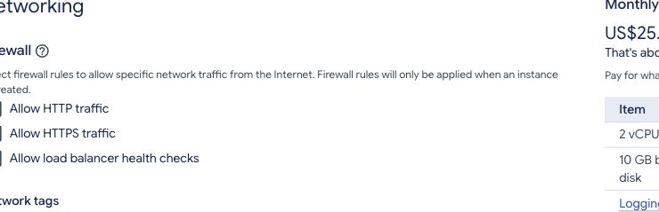
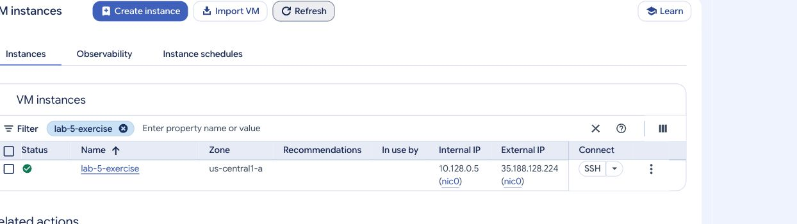

# Exercise 1 — Create a VM independently

Previous: [Linux basics](part-3.md) · [Week 5 overview](../README.md) · Next: [Exercise 2](exercise-2.md)

Create a second VM from an empty **Create instance** form. Apply the tutorials rather than cloning the main VM. Keep it for Exercise 2.

## Task 1. Build the specified VM

| Setting | Required value |
| --- | --- |
| Name | `lab-5-exercise` |
| Region / zone | `us-central1` / `us-central1-a` |
| Series / type | E2 / `e2-medium` |
| Resources | 2 shared vCPUs, 4 GB RAM |
| Provisioning model | Standard |
| Operating system | Ubuntu 24.04 LTS, x86/64, not Minimal |
| Boot disk | 10 GB balanced persistent disk; delete with the VM |
| Backups | No scheduled backups |
| Network | Default network and regional subnet, ephemeral external IPv4 |
| HTTP / HTTPS | Both unchecked |

This VM needs no web traffic. Confirm each setting before creating it. Once running, inspect the VM details to verify them.

The HTTP/HTTPS checkboxes control inbound web traffic. Leaving them unchecked does not disable SSH or prevent normal outbound package downloads.



<details>
<summary>Hint — find the configuration</summary>

Open **Compute Engine → VM instances → Create instance**. Use Machine configuration for E2 and the zone, **OS and storage → Change** for Ubuntu and the disk, and **Networking** for the traffic checkboxes. See [Part 1](part-1.md).

</details>

## Task 2. Connect and create an administrator user

Use the **SSH** button on the `lab-5-exercise` row. Alternatively, use the optional Cloud Shell route, replacing the project placeholder:

```bash
gcloud compute ssh lab-5-exercise --zone=us-central1-a --project=YOUR_PROJECT_ID
```

Once connected, confirm `hostname -s` is `lab-5-exercise`, then:



1. Create Linux user `case` with its own password and home directory.
2. Add it to `sudo` without removing other memberships.
3. Switch to a login shell as `case`.
4. Verify identity, home directory, group membership, and administrator access.

| Check | Expected result |
| --- | --- |
| `hostname -s` | `lab-5-exercise` |
| `whoami` | `case` |
| `pwd` immediately after switching | `/home/case` |
| `id` | Includes user `case` and group `sudo`. |
| `sudo whoami` | `root` |
| `whoami` after sudo | Still `case`. |

<details>
<summary>Hint — create, grant access, then switch</summary>

Run the first two commands as the initial SSH account:

```bash
sudo adduser case
sudo usermod -aG sudo case
su - case
```

Use the `case` password for `su` and when sudo requests it. See [Part 2](part-2.md) for explanations and troubleshooting.

</details>

## Task 3. Reconnect using the same account

Exit the lab-user shell and then the SSH session. Reconnect with the VM’s **SSH** button (or repeat the optional Cloud Shell command above), check the hostname, and switch to the existing `case` account. Repeat the checks above. Do not create it again.

### Completion checks

- [ ] VM details match the specification.
- [ ] HTTP and HTTPS are unchecked.
- [ ] `case` has a home directory and belongs to `sudo`.
- [ ] Sudo works while your normal shell remains `case`.
- [ ] Reconnecting reuses the same account.

Keep the VM running and continue as `case` to [Exercise 2 — Files, folders, and pico](exercise-2.md). Cleanup follows that exercise.
