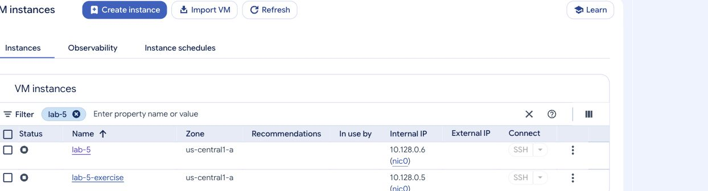

# Exercise 2 — Files, folders, and pico

Previous: [Exercise 1](exercise-1.md) · [Week 5 overview](../README.md) · Next: [Research homework](../homework/homework-2.md)

Use `lab-5-exercise` as `case`, with administrator privileges only for installing software. If you reconnected, switch to the existing `case` account first.

## Task 1. Prepare your workspace

Inside `/home/case`, create:

```text
linux-practice/
├── notes/
└── backups/
```

Confirm your user, current directory, and the two subdirectories.

<details>
<summary>Hint — create directories together</summary>

```bash
cd ~
mkdir -p linux-practice/notes linux-practice/backups
cd linux-practice
whoami
pwd
ls -l
```

Expect `case`, `/home/case/linux-practice`, and two directories owned by `case`.

</details>

## Task 2. Install and verify pico

Refresh the package list and install the Ubuntu package supplying `pico`. Confirm its executable path and version before opening it.

<details>
<summary>Hint — the package and command have different names</summary>

```bash
sudo apt update
sudo apt install nano
command -v pico
pico --version
```

APT may report nano is already installed. This is fine if pico is available.

</details>

## Task 3. Create and edit a file

Use pico to create `notes/session.txt` containing:

```text
VM: lab-5-exercise
User: case
Today I created folders and edited a file on Linux.
```

Save, exit, and display it. Reopen it, add a fourth line, save, exit, and display it again:

```text
I verified that my changes were saved.
```

<details>
<summary>Hint — open, save, and check</summary>

From `~/linux-practice`, run `pico notes/session.txt`. Save using **Ctrl+O → Enter** and exit with **Ctrl+X**. Inspect with `cat notes/session.txt`. Do not run the editor with sudo.

</details>

## Task 4. Copy, rename, and inspect

1. Copy the file to `backups/session-copy.txt`.
2. Rename the copy to `session-backup.txt`.
3. List `.txt` files in both directories using a wildcard.
4. Display the backup and confirm the same four lines.
5. Verify that both files belong to `case`.
6. Search the original file for `User:` and show its line number. Then find the line mentioning Linux using a case-insensitive search for `linux`.

<details>
<summary>Hint — copying preserves the original</summary>

```bash
cp notes/session.txt backups/session-copy.txt
mv backups/session-copy.txt backups/session-backup.txt
ls notes/*.txt backups/*.txt
cat backups/session-backup.txt
ls -l notes/session.txt backups/session-backup.txt
grep -n "User:" notes/session.txt
grep -i "linux" notes/session.txt
```

Expect `2:User: case` from the first search and the sentence about creating folders on Linux from the second. These commands search contents without changing the file.

</details>

## Task 5. Remove only the backup

Inspect the path, remove the backup with an interactive confirmation, then remove the empty backup directory. Verify the original file and contents remain.

<details>
<summary>Hint — check before deleting</summary>

```bash
pwd
ls -l backups
rm -i backups/session-backup.txt
rmdir backups
cat notes/session.txt
```

Confirm only the named backup. Keep `notes` and its original file.

</details>

> **Troubleshooting challenge — an unexpected deletion error**
>
> After removing the backup, `rmdir backups` reports that the directory is not empty, although `ls backups` shows nothing. What would you inspect next? Why is adding `sudo` or switching to recursive deletion a poor first response?

<details>
<summary>Show answer</summary>

Use `pwd` to confirm the location, then `ls -la backups` to inspect hidden entries as well as visible ones. `.` and `..` are normal directory entries and do not prevent removal; another hidden file could. Inspect any actual file before deciding whether it is disposable. Sudo does not make a non-empty directory empty, and recursive deletion can remove work you have not inspected. The exercise requires deleting only the practice backup, so preserve unexpected files until you understand their purpose.

</details>

### Check your work before deleting the VM

- [ ] You are `case` on `lab-5-exercise`.
- [ ] Pico was installed or verified before use.
- [ ] The original file has four saved lines and belongs to `case`.
- [ ] You copied, renamed, listed, and read a backup.
- [ ] Grep found the user line with its line number and matched Linux regardless of case.
- [ ] Only the backup file and empty backup directory were removed.

Record the VM configuration and terminal checks in your notes before cleanup. If your instructor requests screenshots, exclude passwords and coupon codes.

## Task 6. Clean up cloud resources

1. Exit the `case` shell and then the SSH session. Close the SSH window, or leave the optional Cloud Shell panel. Open **Compute Engine → VM instances** in the correct project.
2. Select **only `lab-5-exercise`** and choose **Delete**, possibly under **More actions** on a narrow screen.
3. Check the VM name and ensure its boot disk will also be deleted. This removes its files, including the practice work. Confirm deletion.
4. Wait until it disappears. Check **Compute Engine → Disks** to confirm its boot disk is gone. Remove a leftover disk only after confirming it belongs to this exercise.
5. Select **only `lab-5`**, choose **Stop**, and confirm. Wait for **Stopped** (`TERMINATED` in command-line output). If the table shows only a status icon, hover over it or open the VM details to check its state. Keep its disk and user for Week 6.



*Example of the main VM's stopped state. Check exercise-VM and boot-disk deletion separately; this cropped image does not demonstrate deletion.*

Stopping preserves files and users but does not eliminate storage charges. Deleting the disposable VM and boot disk removes those resources. Do not delete unrelated VMs or disks. See [Google's stop/start guidance](https://docs.cloud.google.com/compute/docs/instances/stop-start-instance).

### Final checks

- [ ] Exercise VM and its boot disk are deleted.
- [ ] Main VM is stopped with its boot disk retained.
- [ ] Remaining grant credit is checked.

Continue to the [cloud users and sudo research homework](../homework/homework-2.md).
