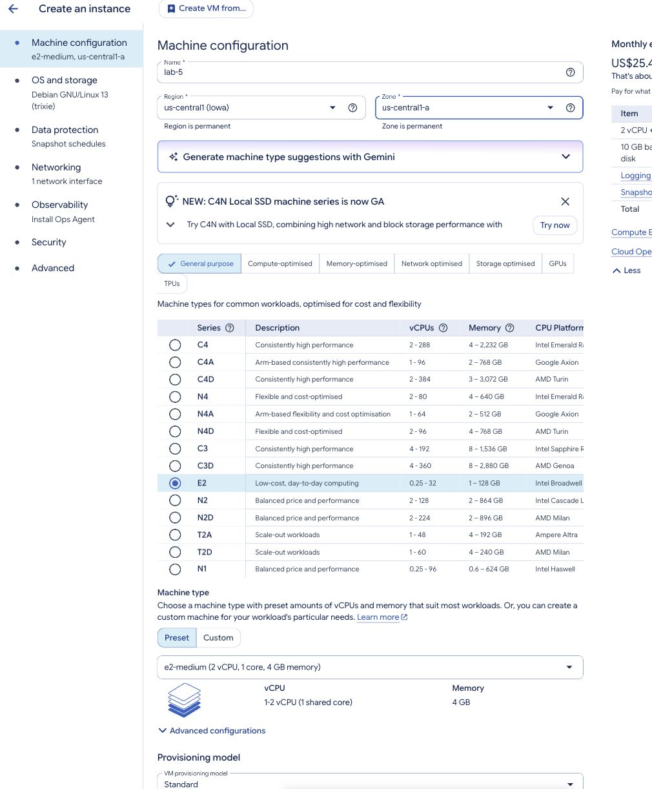
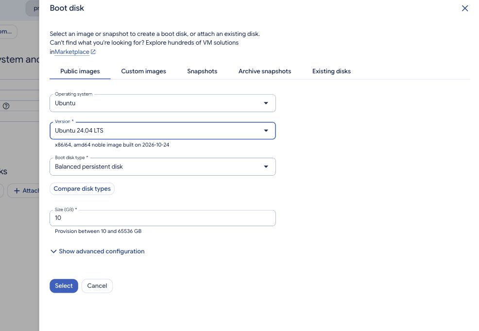
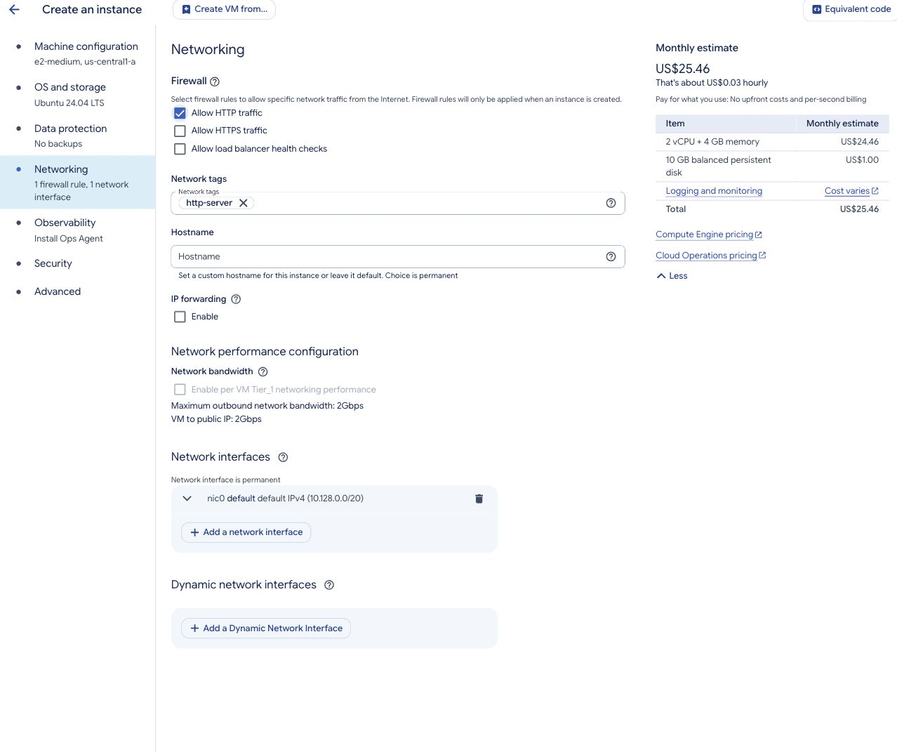
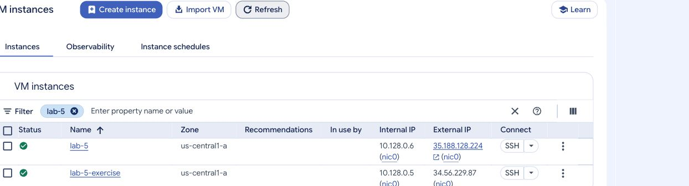

# Part 1 — Create your first VM

Previous: [Preparation](../preparation.md) · [Week 5 overview](../README.md) · Next: [SSH, users, and sudo](part-2.md)

Create an Ubuntu VM called `lab-5`. Google manages the physical hardware; you choose the virtual hardware and manage the operating system. This is **infrastructure as a service**, or IaaS.

Before starting, complete the [preparation guide](../preparation.md): request and redeem your coupon, link the grant billing account to your project, and enable the Compute Engine API. Do not create a VM until the credit and project linkage are confirmed.

## 1. Open Compute Engine

1. Search for **Compute Engine**, then open **VM instances**.
2. If prompted, enable the **Compute Engine API** and wait. If already enabled, continue.
3. Select **Create instance**.

## 2. Configure the VM

Use these values rather than accepting the default machine size.

| Setting | Value |
| --- | --- |
| Name | `lab-5` |
| Region / zone | `us-central1` (Iowa) / `us-central1-a` |
| Machine family / series | General purpose / E2 |
| Machine type | `e2-medium` |
| Resources | 2 shared vCPUs, 4 GB RAM |
| Provisioning model | Standard |
| Operating system | Ubuntu 24.04 LTS, x86/64 (not Minimal) |
| Boot disk | 10 GB balanced persistent disk (`pd-balanced`) |
| Backups | No scheduled backups for this temporary lab |
| Network | `default`, with its `us-central1` subnet |
| External IP | Ephemeral IPv4 |
| HTTP / HTTPS | Allow HTTP; leave HTTPS unchecked |

`e2-medium` exposes two virtual CPUs to Linux, but CPU time is shared. These are not two dedicated physical cores. Its sustained allocation totals the equivalent of one vCPU, with temporary bursting. See [Google's E2 specifications](https://docs.cloud.google.com/compute/docs/general-purpose-machines).

In **Machine configuration**, select **General purpose → E2**, keep **Preset**, and choose **e2-medium** in the machine-type list. Check the region and zone near the top of the page. Scroll down to confirm the **VM provisioning model** is **Standard**.

*This capture shows the machine settings before changing the operating system and backups. Complete the Ubuntu and No backups steps below even if the sidebar still shows defaults at this stage.*

Under **OS and storage**, select **Change**, choose the Ubuntu image and disk settings, then confirm. Keep the option to delete the boot disk when the VM is deleted enabled.

Open **Data protection** and select **No backups**. The default can be a snapshot schedule, so check this explicitly. This VM is for lab work; keep any important coursework in your own version-controlled project as well.

Under **Networking**, enable **Allow HTTP traffic** for this main VM. Week 6 publishes a container on port 80; this lab does not install a web server. HTTPS remains unchecked. An external IP alone does not mean a website is running.

If the default network is unavailable or an organisation policy blocks the zone or external IP, ask the instructor before changing the specification.

## 3. Create and check

1. Review the configuration and estimated cost, then select **Create**.
2. Wait for **Running**, indicated by a green status icon.
3. Open the VM details and confirm its type, zone, Ubuntu version, and disk size. Record its name, zone, and external IP.

An ephemeral external IP can change after a stop/start. Check its current value next week.

> **Think it through — stopped versus deleted**
>
> You stop `lab-5` tonight and start it next week. Which resources and files should still exist? Why might your credit balance still decrease while the VM is stopped?

Show answer

Stopping the VM preserves its boot disk, installed software, Linux users, and saved files. Compute usage charges stop, but retained disk storage and any other chargeable resources can still consume credit. Deleting a VM is different: if its boot disk is also deleted, the files on that disk are lost. This is why the main VM is stopped for Week 6 while the disposable exercise VM and its disk are deleted.

### Checkpoint

- [ ] The correct project and grant billing account are selected.
- [ ] `lab-5` is running with the specified configuration.
- [ ] HTTP is allowed for Week 6; HTTPS is unchecked.
- [ ] You can find the VM’s SSH button and have recorded the project ID. Cloud Shell is optional.

Keep the VM running and continue to [Part 2 — SSH, users, and sudo](part-2.md).
