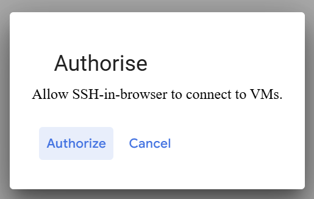
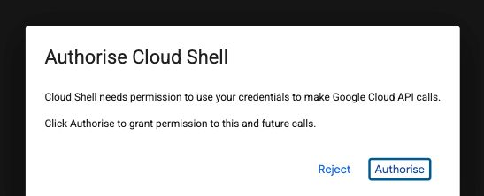

# Part 2 — SSH, users, and sudo

Previous: [Create your VM](part-1.md) · [Week 5 overview](../README.md) · Next: [Linux basics](part-3.md)

Connect to `lab-5`, create its lab user once, and use that account for everyday work. Use `sudo` when an individual command needs administrator access.

## 1. Understand the accounts

| Account | Purpose |
| --- | --- |
| Google account | Signs in to Google Cloud and controls access to the cloud project. |
| Initial SSH account | Linux account used when the console connects to the VM. Its name depends on your Cloud configuration. |
| `student` | Linux account you create on `lab-5`, with its own home directory and password. |
| `root` | Built-in Linux administrator with unrestricted system access. |

The Linux password created here is separate from your Google password. Membership of Linux's `sudo` group does not grant Google Cloud project permissions.

## 2. Connect to the VM using SSH

**SSH (Secure Shell)** opens a terminal session on a remote computer. For this lab, use the VM's **SSH** button; Cloud Shell is an optional alternative described below. Both methods connect to the same Ubuntu VM.

1. Open **Compute Engine → VM instances** in your module project.
2. Check that `lab-5` is running and choose **SSH** on its row.
3. Allow the browser window to open. Review and accept an SSH authorization prompt if it appears, then wait for the terminal.



*Source example; the prompt may not reappear in an already authorized browser.*

Run these commands in the connected terminal:

```bash
hostname -s
whoami
pwd
```

Expect the short hostname `lab-5`. Plain `hostname` may include the zone and project domain; `hostname -s` prints just the short name. Your initial Linux username will depend on your Cloud configuration.

**Continue to user creation only when the short hostname is exactly `lab-5`.** If it differs, stop and check which VM or Cloud Shell session you are using.

| Location | Typical prompt or check | Commands to run there |
| --- | --- | --- |
| Cloud Shell | Contains `@cloudshell` and often the project ID | `gcloud config get-value project`, `gcloud compute ssh ...` |
| Initial SSH session on the VM | `hostname -s` returns `lab-5` | Create the lab user and grant sudo membership. |
| Lab-user shell on the VM | `whoami` returns `student` | Linux practice and coursework; sudo only when needed. |

If the hostname contains `cloudshell`, you have not reached your VM. **Do not create the lab user or install the lab packages in Cloud Shell.** Complete the SSH connection first. Cloud Shell and your VM have separate users, home directories, and installed software.

### Optional — connect through Cloud Shell

You can complete the lab using the SSH button throughout. **Cloud Shell is optional.** If already connected through the SSH button, skip this subsection and continue to Section 3. [Cloud Shell](https://docs.cloud.google.com/shell/docs) is a Google-managed shell environment accessed from your browser. It includes the Google Cloud CLI (`gcloud`) and other tools for managing cloud resources without installing them on your own computer. It also offers an editor.

Opening Cloud Shell gives you a terminal in its own environment; it does not automatically connect you to `lab-5`. Its users, home directory, and installed software are separate from your lab VM. Use it when you want to manage resources with commands or practise the command-line SSH route. For this lab, run package installation, user creation, and file exercises only after connecting to the VM.

1. In the Cloud Console, check the selected project and click **Activate Cloud Shell** (`>_`) in the top bar.
2. Wait for the terminal panel. If **Authorise Cloud Shell** appears, review and authorize it to make Google Cloud API calls using your account. This prompt may not appear on later visits.



3. In **Cloud Shell**, check the selected project:

```bash
gcloud config get-value project
```

Compare the output with the project ID recorded in Part 1. The project ID differs from the display name in some projects.

4. Replace `YOUR_PROJECT_ID` below with your actual project ID. Run this command in **Cloud Shell**:

```bash
gcloud compute ssh lab-5 --zone=us-central1-a --project=YOUR_PROJECT_ID
```

The name selects the VM, `--zone` selects its zone, and `--project` selects the project explicitly. The VM must be running.

On your first connection, gcloud may report that no SSH key exists:

- If it asks to create the `.ssh` directory and generate a key, check that you are connecting to your own VM, then confirm with `Y`.
- If **Enter passphrase (empty for no passphrase)** appears, choose whether to protect the SSH key with a passphrase. If you choose one, type it twice when asked; the characters are hidden. Remember it for future SSH connections. This is separate from the Linux lab-user password created below. Leaving it empty means the stored key has no passphrase protection.
- Review any host-key prompt for the VM you intended to reach. These first-use prompts normally do not appear on every connection.

This follows [Google's instructions for connecting to a Linux VM from Cloud Shell](https://docs.cloud.google.com/compute/docs/connect/standard-ssh#gcloud).

After SSH connects, run `hostname -s`, `whoami`, and `pwd` as above. Continue only when the short hostname is `lab-5`. On `lab-5-exercise`, substitute that VM name and expect `lab-5-exercise` instead.

## 3. First connection only — create the lab user

As the initial SSH account on `lab-5`, run:

```bash
sudo adduser student
```

Choose and confirm a password. **Nothing appears while you type**, including dots or stars; this is normal. Remember it, keep it private, and do not reuse your Google password. Press Enter to skip optional personal details, then confirm with `Y`.

Grant administrator access:

```bash
sudo usermod -aG sudo student
```

`-aG` appends the user to a supplementary group while preserving existing group memberships. Do not omit `-a`.

If the user already exists, follow the reconnect section below. Do not create another account. If administrator commands fail for the initial account, ask the instructor to check your VM access.

## 4. Switch to the lab user and verify

```bash
su - student
```

Enter the **student Linux password**. The hyphen starts a login shell, loads the user's environment, and moves into their home directory.

| Command | Expected result |
| --- | --- |
| `whoami` | `student` |
| `pwd` | `/home/student` |
| `id` | User `student`, with `sudo` among its groups; numeric IDs may vary. |
| `sudo whoami` | `root`, after the student password if requested. |

`sudo whoami` runs only that command as administrator. Run plain `whoami` again: your interactive shell is still `student`.

Use sudo for package installation and system changes. Create and edit your coursework files without sudo, so they belong to your lab user. Avoid a persistent root shell in this lab.

<details>
<summary>What if student is not in the sudoers file?</summary>

Run `exit` once to return to the initial SSH account. Run `sudo usermod -aG sudo student` there, then start a new login shell with `su - student`. Repeat the checks. An existing shell does not automatically gain a newly assigned group membership.

</details>

<details>
<summary>What if account creation was interrupted before the password was set?</summary>

Return to the initial VM account and check `id student`. If the account exists, finish its password setup using `sudo passwd student`, then confirm its sudo membership with `sudo usermod -aG sudo student`. Start a new login shell with `su - student` and repeat the verification. Use `case` instead on the exercise VM. Do not try to solve a missing password by repeatedly creating new accounts.

</details>

> [!WARNING]
> **Use sudo for the command that needs it.** `sudo apt install nano` installs system software. In contrast, `sudo pico ~/notes.txt` may create a root-owned file in your home directory, causing later edits as your normal user to fail. Use `pico ~/notes.txt` for your own notes and check ownership with `ls -l ~/notes.txt`. Do not add sudo automatically whenever a command reports an error.

> **Predict the result — who is the administrator?**
>
> After `su - student`, you run `sudo whoami`, then `whoami`. What should each print, and why? If a newly added sudo-group membership is missing from `id` in an already open shell, what should you try before changing permissions again?

<details>
<summary>Show answer</summary>

`sudo whoami` prints `root` because that one command runs as administrator. Plain `whoami` still prints `student`; sudo did not change the interactive shell's identity. Group membership is established when a login session starts. Exit to the initial SSH account, start a fresh `su - student` login shell, and check `id` again. Only if sudo membership is still absent should you check whether the group assignment succeeded.

</details>

## 5. Reconnect using the existing user

On later visits, start `lab-5` if it is stopped, then use its **SSH** button again. If you prefer the optional Cloud Shell route, reconnect with:

```bash
gcloud compute ssh lab-5 --zone=us-central1-a --project=YOUR_PROJECT_ID
```

Replace the project placeholder as before. Once SSH connects, check:

```bash
hostname -s
whoami
```

If not already `student`, switch:

```bash
su - student
```

Then verify:

```bash
whoami
pwd
id
sudo whoami
```

**Do not run adduser again on this VM.** Users and files persist on its disk across stop/start. On the exercise VM, follow this process using `case` instead of `student`.

## 6. Understand exit

`su - student` creates a shell inside the initial SSH shell:

1. `exit` once returns from `student` to the initial account **on the VM**.
2. `exit` again disconnects the SSH session in the browser window. You can close that window.
3. If you connected through the optional Cloud Shell route, the second exit returns to Cloud Shell instead; its prompt often contains `@cloudshell`. Close the panel when finished.

Use `hostname -s` and `whoami` whenever you are unsure where you are. Disconnecting SSH does not stop the VM.

Practise exiting both shells, reconnecting, and following Section 5. Continue when the checks show `student`, `/home/student`, and working sudo access.

### Checkpoint

- [ ] `student` exists on `lab-5` and belongs to `sudo`.
- [ ] Switching opens its home directory.
- [ ] `sudo whoami` prints `root`; plain `whoami` still prints `student`.
- [ ] Reconnecting reuses the same user.

Continue to [Part 3 — Linux basics](part-3.md).
