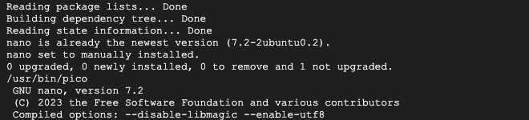

# Part 3 — Linux basics

Previous: [SSH, users, and sudo](part-2.md) · [Week 5 overview](../README.md) · Next: [Exercise 1](exercise-1.md)

Work inside the SSH session **connected to `lab-5` using its SSH button or the optional Cloud Shell route**, as `student`. Check `hostname -s` first: it must show `lab-5`, not a Cloud Shell host. After reconnecting, [switch to the existing user first](part-2.md#5-reconnect-using-the-existing-user).

## 1. Understand the prompt and paths

Your prompt resembles:

```text
student@lab-5:~$
```

`student` is the user, `lab-5` the host, and `~` the home directory. `$` marks a normal-user prompt: **do not type it** when copying commands. Root shells often use `#` instead.

A **directory** is a folder. `/home/student` is an absolute path, starting at the filesystem root `/`. `cloud-practice/notes.txt` is a relative path, starting from your current directory. `.` means the current directory and `..` its parent. Filesystem root `/` and administrator account `root` are different concepts.

Run these separately and inspect their output:

```bash
whoami
pwd
ls
ls -la
```

`ls -la` includes hidden entries, permissions, owner, group, size, and modification time. Names are case-sensitive: `Notes.txt` and `notes.txt` are different files.

## 2. Navigate and create directories

```bash
cd ~
mkdir cloud-practice
cd cloud-practice
pwd
mkdir notes backups
ls
cd notes
pwd
cd ..
```

Finish in `/home/student/cloud-practice` with `notes` and `backups` inside. If repeating the tutorial, inspect existing directories before reusing them; a `File exists` message is not a reason to delete previous work.

| Command | Meaning |
| --- | --- |
| `cd notes` | Enter a directory relative to your location. |
| `cd ..` | Move to the parent directory. |
| `cd` or `cd ~` | Return home. |
| `clear` | Clear the terminal display without deleting files. |

For nested folders, `mkdir -p` creates missing parent directories too. For example, `mkdir -p ~/cloud-practice/notes` ensures that path exists; it leaves existing files in place. Use ordinary `mkdir` when you want a warning that a directory already exists.

## 3. Create and read a file

From `~/cloud-practice`, run:

```bash
touch notes/commands.txt
echo "I am learning Linux on a cloud VM." > notes/commands.txt
echo "My lab user is student." >> notes/commands.txt
cat notes/commands.txt
```

`touch` creates a missing empty file, or updates an existing file's timestamps. `echo` prints text. `>` redirects output and **replaces existing contents**; `>>` appends. `cat` displays a file.

> [!WARNING]
> **Redirection can overwrite your work.** `echo "Replacement" > notes/commands.txt` replaces the existing file contents immediately; it does not ask for confirmation. Use `>>` when you intend to append. Do not run that replacement example on the tutorial file unless you intend to discard its contents.

> **Predict before trying — paths and output**
>
> You are inside `~/cloud-practice/notes`. Would `cat notes/commands.txt` find the file you just created? Give two paths that would work from this location. How would you add a line without removing the existing text?

<details>
<summary>Show answer</summary>

The relative path `notes/commands.txt` would look for a second `notes` directory inside the current one. Use `cat commands.txt` or `cat ~/cloud-practice/notes/commands.txt`. To append from this location, use `echo "Another note" >> commands.txt`. Return to `~/cloud-practice` before continuing the tutorial's examples.

</details>

## 4. Install the editor before using it

```bash
sudo apt update
sudo apt install nano
command -v pico
pico --version
```

`apt update` refreshes package lists without upgrading all software. `apt install nano` installs GNU nano, which also supplies `pico` on this Ubuntu setup. Review the installation prompt and confirm with `Y` if asked. If already installed, APT reports that instead.

`command -v pico` should print an executable path. If it prints nothing, check the installation output before continuing. See the [Ubuntu nano package](https://packages.ubuntu.com/noble/nano).



*Package verification captured on the exercise VM. The full Ubuntu image already included nano; running the installation command confirmed its availability.*

## 5. Edit, save, reopen, and verify

```bash
pico notes/commands.txt
```

Use the arrow keys and add a third line:

```text
I can edit and save a text file using pico.
```

1. Press **Ctrl+O** (letter O) to write the file.
2. Press **Enter** to confirm its filename.
3. Press **Ctrl+X** to exit.

`^O` and `^X` at the bottom mean Ctrl+O and Ctrl+X. Hold **Control**, not Command on a Mac. These are shortcuts, not text to type. See the [nano shortcut reference](https://www.nano-editor.org/dist/v5/cheatsheet.html).

```bash
cat notes/commands.txt
pico notes/commands.txt
```

Change `learning Linux` to `practising Linux`, save, and exit again. Use `cat notes/commands.txt` to confirm the change persisted.

## 6. Search inside a file with grep

Use `cat` when you want to read a whole short file. Use `grep` when you want only lines containing particular text. From `~/cloud-practice`, try:

```bash
grep "Linux" notes/commands.txt
grep -n "student" notes/commands.txt
grep -i "linux" notes/commands.txt
```

The first command prints the line containing `Linux`. `-n` adds the matching line number; the second command should show `2:My lab user is student.`. `-i` ignores letter case, so `linux` also matches `Linux`. Quotes keep the search text together, especially when it includes spaces.

`grep` searches **file contents**; `ls notes/*.txt` lists **filenames**. Ordinary grep patterns are case-sensitive and may contain special pattern characters. Use `grep -F "My lab user" notes/commands.txt` to search for literal text. If nothing matches, grep normally prints nothing and returns status 1; it has not deleted or changed the file. See the [GNU grep manual](https://www.gnu.org/software/grep/manual/grep.html).

> **Choose the right tool — names or contents?**
>
> A directory contains `linux.txt` whose text never mentions Linux, and `session.txt` whose text does. Would `ls notes/*linux*` and `grep -i "linux" notes/*.txt` necessarily identify the same file? Explain what each command searches. You can reason about this without creating the extra files.

<details>
<summary>Show answer</summary>

No. The wildcard in the `ls` command selects filenames containing the lowercase text `linux`, so it selects `linux.txt`. Grep searches the contents of the `.txt` files for Linux regardless of case, so it finds the matching line in `session.txt`. A filename match does not imply a content match. When searching multiple files, grep normally prefixes matching lines with the filename.

</details>

## 7. Copy, rename, and inspect

```bash
cp notes/commands.txt backups/commands-copy.txt
mv backups/commands-copy.txt backups/commands-backup.txt
ls notes/*.txt
ls -l notes backups
```

`cp` copies; `mv` moves or renames. `*.txt` matches names ending in `.txt`. Both files should belong to `student` because you created them without sudo.

To copy an entire directory, the general form is `cp -r source destination`. Replace those names with actual directories when needed.

## 8. Remove only the practice backup

Check the location and target first:

```bash
pwd
ls -l backups
rm -i backups/commands-backup.txt
rmdir backups
ls
```

Answer `y` for the named backup. `rm` deletes without a recycle bin. `rmdir` removes only an empty directory. Keep your original `notes/commands.txt`.

> [!WARNING]
> **Check paths before deleting.** `rm -i backups/commands-backup.txt` targets one named file; `rm backups/*.txt` can target every matching text file and does not request confirmation. Do not run the wildcard deletion example here. Do not add sudo or `-rf` to fix a deletion error; inspect the location, contents, and ownership instead.

## 9. Get help

```bash
ls --help
help cd
```

`ls` is external; `cd` is built into Bash, so use `help` for it. If `man` is installed, `man ls` opens its manual; press `q` to leave. **Ctrl+C** interrupts a running command when appropriate.

## Command reference

Use the [Linux command reference](linux-command-reference.md) for every command used in the tutorials, with its usage, example, and short description. It also includes a few optional next steps, such as finding files and checking disk space. Keep following the guided commands above in order; the reference is for looking things up.

### Checkpoint

- [ ] Explain `~`, `/`, `.`, `..`, and relative paths.
- [ ] Use `pwd` and `ls` to navigate, `mkdir` to create folders, `cat` to read a file, and `grep` to find matching lines.
- [ ] Confirm pico is installed and edits persist after reopening.
- [ ] Check that your files belong to `student`.
- [ ] Copy and rename a file, then remove only its backup.

Keep `lab-5` for Week 6. Continue to [Exercise 1 — Create a VM independently](exercise-1.md).
