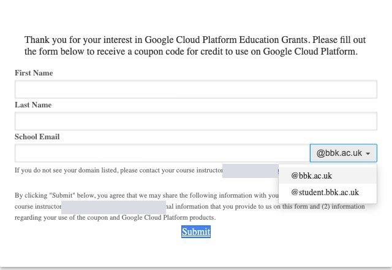
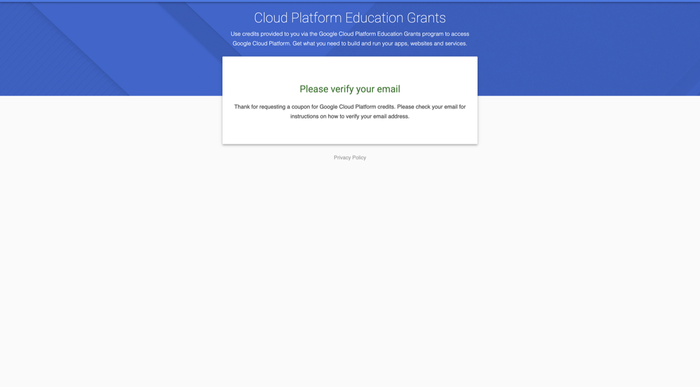
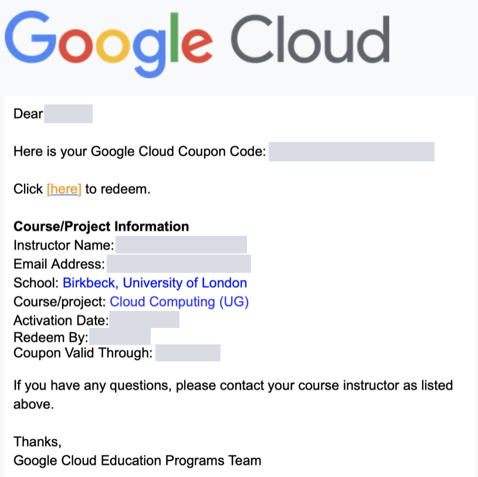
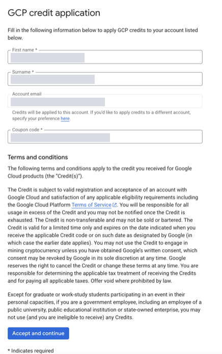
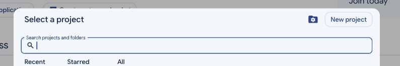
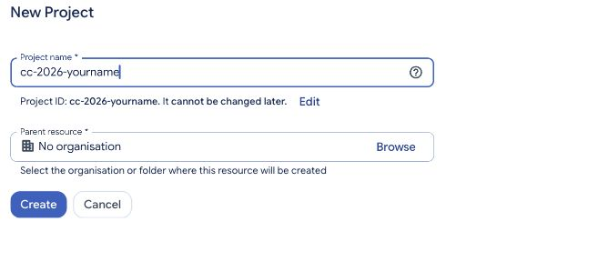
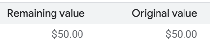
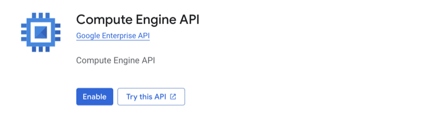

# Preparation — Google Cloud credit and Compute Engine

[Week 5 overview](README.md) · Next: [Part 1 — Create your first VM](lab/part-1.md)

Complete this preparation **before creating a VM**. First request and redeem your education coupon, then connect your project to its billing account and enable Compute Engine. Having a Google account or a coupon email alone does not mean that credit has been applied to a project.

## 1. Check the grant details

The current approval email for **Advanced Cloud Computing sep26** provides:

| Item | Current grant details |
| --- | --- |
| Credit per student coupon | **US$50** |
| Eligible request email domains | `@bbk.ac.uk` and `@student.bbk.ac.uk` |
| Last date to request **and redeem** a coupon | **21 January 2027** |
| Coupon credit valid through | **21 September 2027** |
| Request limit | One code per unique email address; request only your own module coupon. |

These dates come from the instructor's current grant approval, not the older example images. Request and redeem early so there is time to resolve email or account issues. Do not request additional coupons using another address or alias.

## 2. Keep the accounts separate

| Account or resource | Used for |
| --- | --- |
| Birkbeck email address | Proving eligibility and receiving the coupon. |
| Personal Google account | Signing in to the Cloud Console and redeeming the coupon, following the module's account guidance. |
| Cloud billing account | Holds the grant credit and pays for linked project resources. |
| Cloud project | Contains your VMs and other cloud resources. |
| Linux user | Created later, inside each VM; it is separate from all the accounts above. |

Check the Google profile icon before redemption. If several Google accounts are signed in, use a browser profile for your module account so you do not redeem against the wrong account. Never share your coupon code, Google password, or verification codes.

Use an existing personal Google account, or complete Google's **Create account** prompts before redemption if you do not have one. The Birkbeck email used to request the coupon does not have to become your Google sign-in account.

## 3. Request your coupon

1. Open the current [Student Coupon Retrieval Link](https://gcp.secure.force.com/GCPEDU?cid=O%2Fs3EjXKFAPyNeyaRVfbq%2Bym%2BidARa4yWBcZ0GaPjz0Uk%2BjrK9KOhZB4W0kJt7Ud/). It is also available through the module's Moodle Preparation tile. The link may redirect to Google's education-grant form on a Salesforce-hosted site.
2. Enter your own first and last name.
3. In **School Email**, enter the part before `@` if the form provides a separate domain selector. Select the domain that matches your actual Birkbeck address. Do not append a second domain to the text field.



4. Check the complete email address carefully, review the displayed information-sharing notice, and select **Submit** once.
5. Check your Birkbeck inbox and junk/spam folder. Follow the verification email if requested, then wait for the coupon email. The messages may arrive separately.



6. Keep the coupon email available for the redemption step. Do not post it or its code in Teams, a public repository, or screenshots.



*The two images above are examples of the original email workflow, not new coupons. Use the current grant dates in Section 1.*

## 4. Redeem the coupon before using cloud resources

1. Sign in to the **personal Google account** you intend to use throughout the module. Confirm the profile before continuing.
2. Follow the redemption link in **your own coupon email** and enter your code where requested.
3. Complete any required name fields, review the displayed terms, and choose **Accept and continue** if you agree.
4. Wait for confirmation that the credit has been applied. Keep a private note of which Google account and billing account received it.



Do not follow the example image's old address bar or enter a code shown in someone else's image. Each student's coupon is unique. Do not start a paid trial or add a payment card simply because an example screen looks different; ask the instructor if the education-credit route is unclear.

## 5. Create or select your module project

1. Open the [Google Cloud Console](https://console.cloud.google.com/) using the same Google account as redemption.
2. Select the project control beside the Google Cloud logo. If you already have a module project, select it. Otherwise choose **New project**.



3. Use a clear project name, for example `cc-2026-yourname`. Select **No organisation** if this is the available location for your personal account. If your account requires an organisation or folder, ask the instructor which to use.
4. Create the project, wait for completion, and select it. Record its **project ID**; the display name and ID may differ.



*Form example only. VM screenshots later in the guide use an existing instructor project. Students must use their own module project.*

## 6. Link billing and confirm the credit

1. Check that your module project is selected.
2. Open **Billing** from the navigation menu. If the project is not linked to a billing account, use **Link a billing account** and select the account associated with your redeemed education credit. If prompted to choose an account before entering Billing, choose that same grant account.
3. If the project is linked to the wrong billing account, review the project's billing settings and select the education-grant account you are entitled to use. Ask the instructor if the correct account is unavailable; do not substitute a work or unrelated billing account.
4. Open **Credits** for the selected billing account. Inspect the grant, remaining value, and expiry date. If Credits is not visible, check Billing account management/overview and its menu, or ask the instructor; labels can vary with account permissions.



*Retained source example. The current course award is also $50, but your remaining balance can be lower after usage. Your own account is the source of truth for available credit and expiry.*

A coupon code in an email is not yet usable project credit. Check all three: **redeemed coupon → correct billing account → linked project**.

## 7. Enable Compute Engine

**Compute Engine** is the service used to create and run the VMs in this lab. Its **Compute Engine API** must be enabled in your selected project; enabling it does not itself create a VM.

1. Confirm the project selector shows your module project.
2. Search the console for **Compute Engine** and open **VM instances**.
3. If an **Enable** prompt appears for the **Compute Engine API**, select it and wait for activation to complete. Initial setup can take a little time.
4. Alternatively, open **APIs & Services → Library**, search for **Compute Engine API**, open the Google-provided service, and select **Enable**. Do not select an unrelated Marketplace product.



*Retained example because the instructor's project already has this API enabled. Once enabled, your screen can show Manage instead of Enable.*

5. If the API page shows **Manage**, or VM instances already opens with **Create instance**, the API is enabled. Do not disable and re-enable it just to match a screenshot.
6. Return to **Compute Engine → VM instances** and confirm that **Create instance** is available.

If asked to set up billing, return to Section 6. If you see a permissions error, verify the project/account and contact the instructor; do not work around it by using an unrelated organisation project.

## 8. Know where commands will run

In the lab, use **Compute Engine → VM instances → SSH** on your VM's row to open a remote terminal. **Cloud Shell is optional.** It is a separate Google-managed browser terminal with the `gcloud` command already installed, useful for managing cloud resources without installing the CLI locally. You open it using the console's `>_` button. If you choose this route, connect to your VM with:

```bash
gcloud compute ssh lab-5 --zone=us-central1-a --project=YOUR_PROJECT_ID
```

This command will work **after** you create `lab-5` in Part 1. Cloud Shell is a separate Google-managed environment. Your Linux user and file exercises happen inside the VM after this connection succeeds, not directly in Cloud Shell. [Part 2](lab/part-2.md) explains the prompts and the connection steps.

## Troubleshooting before the lab

| What you see | What to check |
| --- | --- |
| No verification or coupon email | Check the exact Birkbeck address, selected domain, and junk folder. Avoid repeated requests; contact the instructor if it does not arrive. |
| Address rejected | Use your actual `bbk.ac.uk` or `student.bbk.ac.uk` address and the matching selector. A personal Gmail address is not eligible for the request form. |
| Coupon already redeemed | Check the Google account and billing account used previously. Do not try to redeem it again or request another code. |
| No credit in Billing | Confirm redemption completed, the Google account is correct, and the project is linked to the grant billing account. |
| Request or redemption link expired | Check the 21 January 2027 deadline and contact the instructor. |
| Compute Engine asks for billing or reports access denied | Check project selection, billing linkage, and permissions before creating resources. |

Contact the module instructor through the course channel for help. Do not include passwords, verification codes, or your full coupon code in a public post.

## Ready for the lab

- [ ] I requested one module coupon with my Birkbeck email.
- [ ] I verified the email if asked and redeemed the coupon with the intended Google account.
- [ ] My module project is selected and its project ID is recorded.
- [ ] The project is linked to the grant billing account, and I can see the credit.
- [ ] Compute Engine is enabled and **Create instance** is available.
- [ ] I know how to find the VM’s SSH button and understand that Cloud Shell is an optional, separate environment.

Continue to [Part 1 — Create your first VM](lab/part-1.md).
