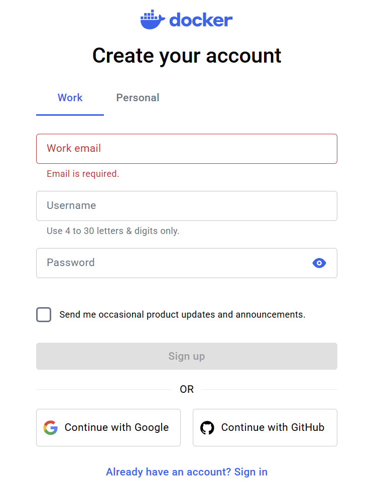
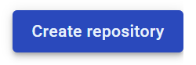
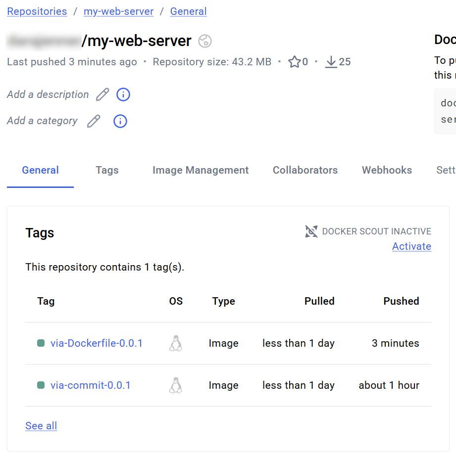
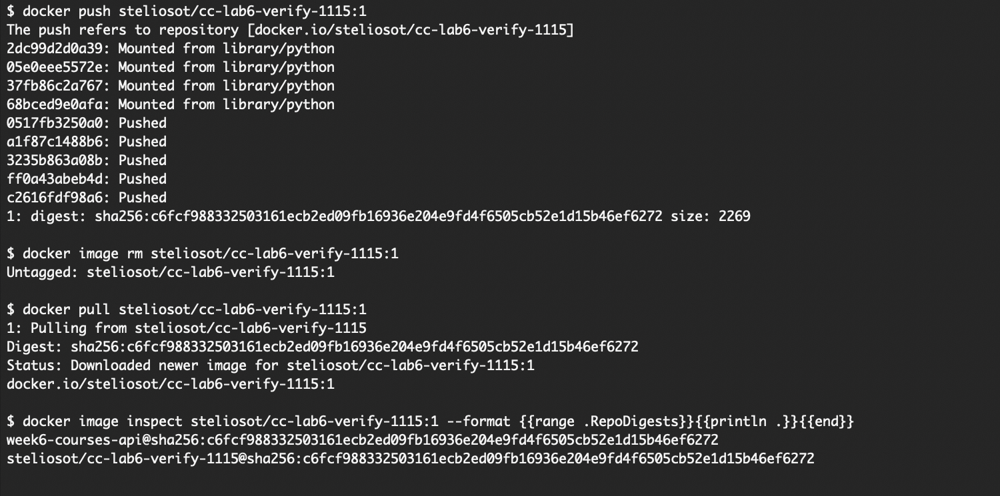

# Tutorial 4 — Publish and run your image with Docker Hub

Previous: [SQLite and Docker volumes](sqlite-and-docker.md) · [Week 6 overview](../README.md) · Next: [Independent exercise](part-3.md)

Publish the Courses API image you built in Tutorial 3, pull it from Docker Hub, and use it to replace your running container. Reattach the same named volume and check that your course record remains. Allow about 25 minutes, plus account verification time.

Run commands **on `lab-5` as `student`**, in `~/week6-fastapi-docker`. You need the local image `week6-courses-api:1`, the `.env` file, and volume `week6-courses-data` from the previous tutorial. Keep the saved course's ID and contents in your notes.

## 1. Understand image names

Docker Hub is an image **registry**. A **repository** groups an application's image versions; a **tag** names a version or variant. A Docker Hub repository stores images, while your Git repository stores the application source. See [Docker's registry introduction](https://docs.docker.com/get-started/docker-concepts/the-basics/what-is-a-registry/).

| Reference | Meaning |
| --- | --- |
| `ubuntu:24.04` | Docker Official Image `ubuntu`, with tag `24.04`; its full reference is `docker.io/library/ubuntu:24.04`. |
| `week6-courses-api:1` | The local image you built in Tutorial 3. |
| `your-docker-id/week6-courses-api:1` | Tag `1` in a repository under your Docker Hub namespace. |

The **Docker Official Image** badge identifies [Docker's curated image collection](https://docs.docker.com/docker-hub/image-library/trusted-content/#docker-official-images). Your personal image belongs to your own namespace. When no registry is given, Docker uses Docker Hub; when no tag is given, Docker uses `latest`. That word is a tag name, not a promise of the newest release. This tutorial explicitly uses `:1`. See [Docker's image reference format](https://docs.docker.com/reference/cli/docker/image/tag/) and [default tags](https://docs.docker.com/reference/cli/docker/image/pull/#pull-an-image-from-docker-hub).

## 2. Create an account and public repository

1. Open [Docker Hub](https://hub.docker.com/) on your computer. If you already have an account, sign in and use it. Otherwise, choose **Sign up**, create a personal account, and complete the email verification.
2. Note your **Docker ID** (username). Use it as your namespace in this tutorial, rather than your email address or an organization name.



*Reference from the supplied Lab 02 document: select Personal if asked. The current account screens may differ.*


*Reference location of the account controls on Docker Hub.*

3. Open **My Hub → Repositories** and select **Create repository**.



4. Select your personal namespace, enter **`week6-courses-api`** as the repository name, choose **Public**, then select **Create**. If you already created this repository for the lab, open it from your repository list. Public means others can pull this image. Publish only the teaching application and keep the `.dockerignore` from Part 2.

These steps follow [Docker's repository walkthrough](https://docs.docker.com/get-started/docker-concepts/the-basics/what-is-a-registry/#create-your-first-repository). The reference screenshots illustrate the controls, not the exact current page layout.

## 3. Sign in from the VM using a token

In [Docker Home](https://app.docker.com/), select your avatar → **Account settings** → **Personal access tokens** → **Generate new token**. Give it a description such as `week6-lab`, choose a short expiry, and grant **Repo Read & Write** (or the equivalent **Read & Write** label). This permits pulling and pushing; the default read-only permission cannot push. Keep the token private. See [Docker's token setup](https://docs.docker.com/security/access-tokens/personal-access-tokens/) and [permission descriptions](https://docs.docker.com/security/access-tokens/reference/#repository-permissions).

Back in the VM shell, replace `your-docker-id` below with your actual Docker ID, retaining the assignment syntax:

```bash
cd ~/week6-fastapi-docker
DOCKERHUB_USERNAME=your-docker-id
PUBLISHED_IMAGE="${DOCKERHUB_USERNAME}/week6-courses-api:1"
docker login --username "$DOCKERHUB_USERNAME"
```

At the **Password** prompt, paste your Docker Hub token and press Enter. The input is hidden. Expect **Login Succeeded**. Do not put the token in the command, a project file, a screenshot, or Git. The explicit `--username` selects this interactive credential flow; plain `docker login` may instead offer a browser/device-code flow. See [Docker login](https://docs.docker.com/reference/cli/docker/login/).

Docker retains login credentials on this VM for later commands. We will log out at the end; a token can also be revoked in your account settings.

## 4. Tag and push the existing image

First check that the Tutorial 3 image exists, then give that same image its Docker Hub name:

```bash
docker image inspect week6-courses-api:1 --format '{{.Id}}'
docker tag week6-courses-api:1 "$PUBLISHED_IMAGE"
docker image inspect "$PUBLISHED_IMAGE" --format '{{.Id}}'
```

The two image IDs should match. `docker tag` adds a name to the existing image; it neither rebuilds it nor uploads anything. If the source image is missing, return to Tutorial 3 and build it first. See [Docker tag](https://docs.docker.com/reference/cli/docker/image/tag/).

Upload the tagged image:

```bash
docker push "$PUBLISHED_IMAGE"
```

Wait for the successful push and its `digest: sha256:...` line. Save the complete image reference and digest in your lab notes. The push uploads image content; it does not upload `.env`, running-container changes, or the named volume's database.

Refresh your repository in Docker Hub and open the [**Tags** tab](https://docs.docker.com/docker-hub/repos/manage/hub-images/tags/#view-repository-tags). Confirm that **`1`** appears in **your** `week6-courses-api` repository.



*Reference from Lab 02: this screenshot shows the older sample project `my-web-server` and its `via-Dockerfile-0.0.1` / `via-commit-0.0.1` tags. Your repository must be `week6-courses-api` and your tag must be `1`; do not copy the screenshot's names. No `docker commit` step is needed.*

## 5. Pull the published image and replace the container

If you paused after the SQLite tutorial, check `docker ps -a` and run `docker start courses-api` if it shows `Exited`. If you previously removed the container but kept its named volume, use the `docker run` command in the [SQLite named volume step](sqlite-and-docker.md#6-store-the-database-in-a-named-volume) to recreate it. Wait for `curl -i http://127.0.0.1/health` to return `200 OK`.

Now confirm that the saved record is still present. Replace `your-docker-id` with your Docker ID and `1` with the **actual saved course ID from your notes**. Set these variables in every new SSH shell. Docker keeps its registry login on the VM until you log out.

```bash
cd ~/week6-fastapi-docker
DOCKERHUB_USERNAME=your-docker-id
PUBLISHED_IMAGE="${DOCKERHUB_USERNAME}/week6-courses-api:1"
COURSE_ID=1
curl -i "http://127.0.0.1/courses/$COURSE_ID"
docker inspect courses-api --format '{{json .Mounts}}'
docker volume inspect week6-courses-data
```

Expect your saved row and a mount of `week6-courses-data` at `/data`. Pull the published image while the current container is still running:

```bash
docker pull "$PUBLISHED_IMAGE"
```

The explicit pull contacts Docker Hub. It may report that the image is already up to date and reuse local layers; that is normal after pushing from this VM. Record the `Digest: sha256:...` line, then inspect its repository reference:

```bash
docker image inspect "$PUBLISHED_IMAGE" \
  --format '{{range .RepoDigests}}{{println .}}{{end}}'
```

The output may contain more than one reference. For your evidence, record the full **repository digest** whose prefix is your Docker Hub namespace and repository, such as `your-docker-id/week6-courses-api@sha256:...`. The digest identifies the published image manifest (or image index). A digest reference can replace `name:tag` when pulling or running that content. [Pulling by digest](https://docs.docker.com/reference/cli/docker/image/pull/#pull-an-image-by-digest-immutable-identifier)



*The verification run used a temporary private repository. In your lab, look for the matching digest for your own `week6-courses-api:1` tag.*

After the pull succeeds, stop and remove the current container. Create its replacement from the Docker Hub reference with the same runtime configuration and named volume.

```bash
docker stop courses-api
docker rm courses-api
docker run -d --name courses-api -p 80:8000 --env-file .env \
  --mount type=volume,source=week6-courses-data,target=/data \
  "$PUBLISHED_IMAGE"
docker ps -a
docker logs courses-api
curl --retry 10 --retry-all-errors --retry-delay 1 -i http://127.0.0.1/health
curl -i "http://127.0.0.1/courses/$COURSE_ID"
```

Wait for Uvicorn's startup message, retrying the requests if necessary. Expect `200 OK` and the **same ID, code, title, and lecturer** recorded before replacement. Check the API in Postman using `http://YOUR_VM_EXTERNAL_IP/courses/YOUR_SAVED_ID` too.

The record survives because this replacement uses the same volume **on the same VM**. Docker Hub distributed the application image. Another VM can pull the image, but it will not receive this volume or its database automatically.

## 6. Troubleshoot and finish

<details>
<summary>🟨 Common pitfalls</summary>

- **Login fails or a push is denied.** Use your Docker ID as the username and paste the token at Docker's hidden password prompt. Check its expiry, its write permission, and the namespace in `printf '%s\n' "$PUBLISHED_IMAGE"`.
- **Docker reports `No such image` while tagging.** Run `docker image ls week6-courses-api:1`. If the tag is missing, return to the [SQLite build step](sqlite-and-docker.md#4-configure-the-database-path-and-rebuild).
- **The pull reports `manifest unknown`.** Check the exact repository and tag in Docker Hub and confirm that the previous push reported a digest. If you see a rate-limit message, follow the retry interval in the error.
- **The replacement returns an empty list or exits.** Run `docker ps -a` and `docker logs courses-api`. Check the [SQLite volume mount](sqlite-and-docker.md#6-store-the-database-in-a-named-volume) and the value of `DATABASE_URL`.

</details>

Log out on the VM when you have finished pushing and pulling:

```bash
docker logout
```

Logging out clears the VM's saved registry login. If you plan to complete the [version 2 extension](part-3.md#optional-extension-a-visible-version-2), keep the token until you finish. Then revoke it in Docker Home. [Docker logout](https://docs.docker.com/reference/cli/docker/logout/)

### Checkpoint and next step

- [ ] Distinguish registry, repository, tag, local image ID, and repository digest.
- [ ] Show tag `1` in your public repository and save the full image reference plus digest.
- [ ] Capture the explicit pull and replacement container's successful API response.
- [ ] Show the identical course before and after replacement with the same named volume.
- [ ] Explain why the database was not published to Docker Hub.
- [ ] Log out without exposing a token in your evidence.

Continue to the [independent exercise](part-3.md), which includes final cleanup. Keep the volume until all persistence evidence has been collected. If pausing, stop `courses-api`, then stop `lab-5` in Compute Engine while retaining its disk.
