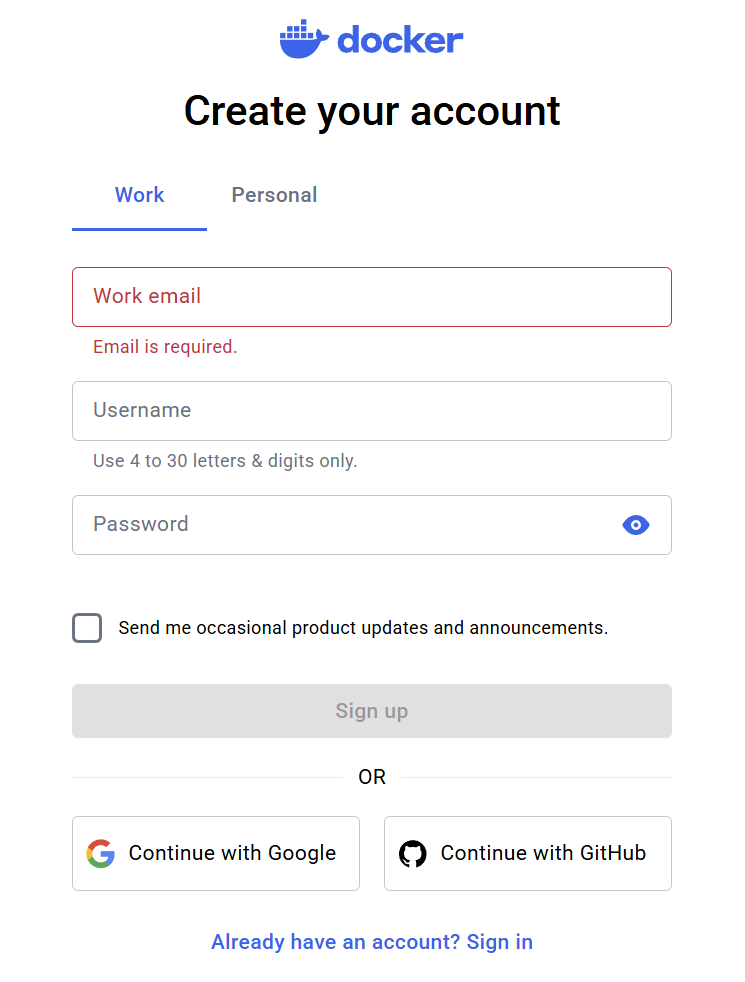
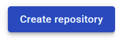
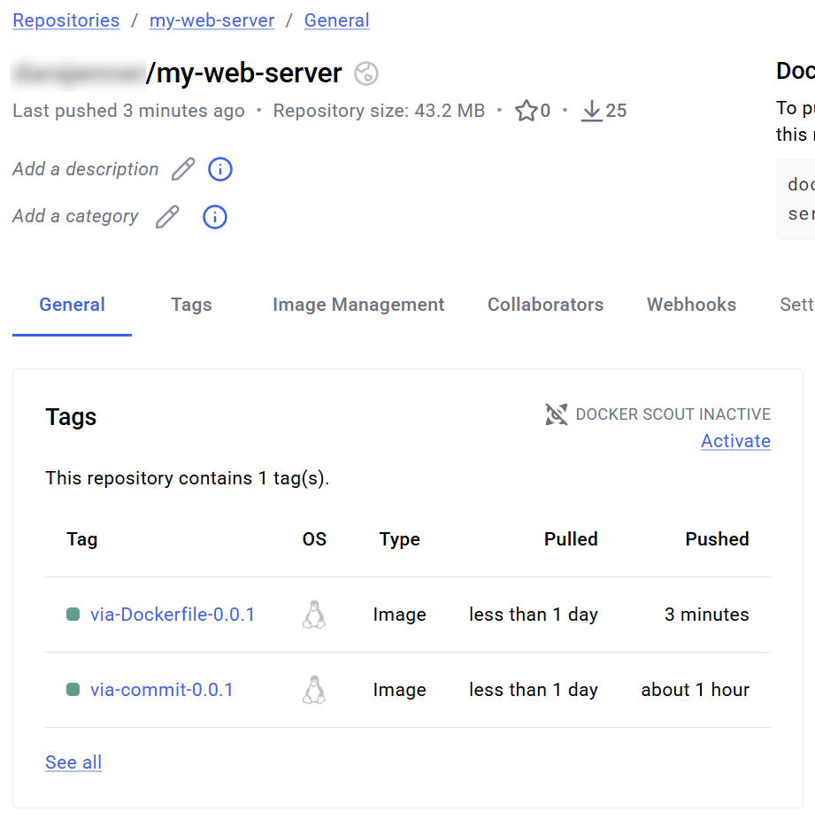

# Tutorial 4 — Publish and run your image with Docker Hub

Previous: [SQLite and Docker volumes](sqlite-and-docker.md) · [Week 6 overview](../README.md) · Next: [Independent exercise](part-3.md)

Publish the Courses API image you built in Tutorial 3, pull it from Docker Hub, and use it to replace your running container. Reattach the same named volume and check that your course record remains. Allow about 25 minutes, plus account verification time.

Run commands **on `lab-5` as `student`**, in `~/week6-fastapi-docker`. You need the local image `week6-courses-api:1`, the `.env` file, and volume `week6-courses-data` from the previous tutorial. Keep the saved course's ID and contents in your notes.

## 1. Understand image names

Docker Hub is an image **registry**. A **repository** groups an application's image versions; a **tag** names a version or variant. A Docker Hub repository stores images, while your Git repository stores the application source. See [Docker's registry introduction](https://docs.docker.com/get-started/docker-concepts/the-basics/what-is-a-registry/).

| Reference | Meaning |
| --- | --- |
| `ubuntu:24.04` | Docker Official Image `ubuntu`, with tag `24.04`; its full reference is `docker.io/library/ubuntu:24.04`. |
| `week6-courses-api:1` | The local image you built in Tutorial 3. |
| `your-docker-id/week6-courses-api:1` | Tag `1` in a repository under your Docker Hub namespace. |

The **Docker Official Image** badge identifies [Docker's curated image collection](https://docs.docker.com/docker-hub/image-library/trusted-content/#docker-official-images). Your personal image belongs to your own namespace. When no registry is given, Docker uses Docker Hub; when no tag is given, Docker uses `latest`. That word is a tag name, not a promise of the newest release. This tutorial explicitly uses `:1`. See [Docker's image reference format](https://docs.docker.com/reference/cli/docker/image/tag/) and [default tags](https://docs.docker.com/reference/cli/docker/image/pull/#pull-an-image-from-docker-hub).

## 2. Create an account and public repository

1. Open [Docker Hub](https://hub.docker.com/) on your computer. If you already have an account, sign in and use it. Otherwise, choose **Sign up**, create a personal account, and complete the email verification.
2. Note your **Docker ID** (username). Use it as your namespace in this tutorial, rather than your email address or an organization name.



*Reference from the supplied Lab 02 document: select Personal if asked. The current account screens may differ.*


*Reference location of the account controls on Docker Hub.*

3. Open your repositories and select **Create repository**.



4. Select your personal namespace, enter **`week6-courses-api`** as the repository name, choose **Public**, then select **Create**. Public means others can pull this image. Publish only the teaching application; keep credentials and live database files out of the image, using the `.dockerignore` from Part 2.

These steps follow [Docker's repository walkthrough](https://docs.docker.com/get-started/docker-concepts/the-basics/what-is-a-registry/#create-your-first-repository). The reference screenshots illustrate the controls, not the exact current page layout.

## 3. Sign in from the VM using a token

In [Docker Home](https://app.docker.com/), select your avatar → **Account settings** → **Personal access tokens** → **Generate new token**. Give it a description such as `week6-lab`, choose a short expiry, and grant **Repo Read & Write** (or the equivalent **Read & Write** label). This permits pulling and pushing; the default read-only permission cannot push. Keep the token private. See [Docker's token setup](https://docs.docker.com/security/access-tokens/personal-access-tokens/) and [permission descriptions](https://docs.docker.com/security/access-tokens/reference/#repository-permissions).

Back in the VM shell, replace `your-docker-id` below with your actual Docker ID, retaining the assignment syntax:

```bash
cd ~/week6-fastapi-docker
DOCKERHUB_USERNAME=your-docker-id
PUBLISHED_IMAGE="${DOCKERHUB_USERNAME}/week6-courses-api:1"
docker login --username "$DOCKERHUB_USERNAME"
```

At the **Password** prompt, paste your Docker Hub token and press Enter. The input is hidden. Expect **Login Succeeded**. Do not put the token in the command, a project file, a screenshot, or Git. The explicit `--username` selects this interactive credential flow; plain `docker login` may instead offer a browser/device-code flow. See [Docker login](https://docs.docker.com/reference/cli/docker/login/).

Docker retains login credentials on this VM for later commands. We will log out at the end; a token can also be revoked in your account settings.

## 4. Tag and push the existing image

First check that the Tutorial 3 image exists, then give that same image its Docker Hub name:

```bash
docker image inspect week6-courses-api:1 --format '{{.Id}}'
docker tag week6-courses-api:1 "$PUBLISHED_IMAGE"
docker image inspect "$PUBLISHED_IMAGE" --format '{{.Id}}'
```

The two image IDs should match. `docker tag` adds a name to the existing image; it neither rebuilds it nor uploads anything. If the source image is missing, return to Tutorial 3 and build it first. See [Docker tag](https://docs.docker.com/reference/cli/docker/image/tag/).

Upload the tagged image:

```bash
docker push "$PUBLISHED_IMAGE"
```

Wait for the successful push and its `digest: sha256:...` line. Save the complete image reference and digest in your lab notes. The push uploads image content; it does not upload `.env`, running-container changes, or the named volume's database.

Refresh your repository in Docker Hub and open its **Tags** view. Confirm that **`1`** appears in **your** `week6-courses-api` repository.



*Reference from Lab 02: this screenshot shows the older sample project `my-web-server` and its `via-Dockerfile-0.0.1` / `via-commit-0.0.1` tags. Your repository must be `week6-courses-api` and your tag must be `1`; do not copy the screenshot's names. No `docker commit` step is needed.*

## 5. Pull the published image and replace the container

Before replacing anything, confirm that the saved record is still present. If you opened a new SSH shell, return to the project and restore all three shell variables below. Replace `your-docker-id` with your Docker ID and `1` with the **actual saved course ID from your notes**. Variables set in a previous shell do not carry over; the registry login remains saved until you log out.

```bash
cd ~/week6-fastapi-docker
DOCKERHUB_USERNAME=your-docker-id
PUBLISHED_IMAGE="${DOCKERHUB_USERNAME}/week6-courses-api:1"
COURSE_ID=1
curl -i "http://127.0.0.1/courses/$COURSE_ID"
docker inspect courses-api --format '{{json .Mounts}}'
docker volume inspect week6-courses-data
```

Expect your saved row and a mount of `week6-courses-data` at `/data`. If you paused the lab, start `courses-api` and wait for startup before checking. Then remove this container, **keeping the named volume**:

```bash
docker stop courses-api
docker rm courses-api
docker pull "$PUBLISHED_IMAGE"
```

The explicit pull contacts Docker Hub. It may report that the image is already up to date and reuse local layers; that is normal after pushing from this VM. Record the `Digest: sha256:...` line, then inspect its repository reference:

```bash
docker image inspect "$PUBLISHED_IMAGE" \
  --format '{{range .RepoDigests}}{{println .}}{{end}}'
```

The output includes a reference such as `your-docker-id/week6-courses-api@sha256:...`. This **repository digest** identifies the published image manifest (or image index). For deployment evidence, record this full reference from `RepoDigests`, rather than only the local image ID printed earlier. These fields serve different purposes; do not rely on their hash values being different, because some Docker engines can show matching values. Tags can be reassigned; a digest identifies fixed content. A digest reference can replace `name:tag` when pulling or running that content. See [pulling by digest](https://docs.docker.com/reference/cli/docker/image/pull/#pull-an-image-by-digest-immutable-identifier).

Create a replacement from the Docker Hub reference, with the same runtime configuration and volume:

```bash
docker run -d --name courses-api -p 80:8000 --env-file .env \
  --mount type=volume,source=week6-courses-data,target=/data \
  "$PUBLISHED_IMAGE"
docker ps -a
docker logs courses-api
curl -i http://127.0.0.1/health
curl -i "http://127.0.0.1/courses/$COURSE_ID"
```

Wait for Uvicorn's startup message, retrying the requests if necessary. Expect `200 OK` and the **same ID, code, title, and lecturer** recorded before replacement. Check the API in Postman using `http://YOUR_VM_EXTERNAL_IP/courses/YOUR_SAVED_ID` too.

The record survives because this replacement uses the same volume **on the same VM**. Docker Hub distributed the application image. Another VM can pull the image, but it will not receive this volume or its database automatically.

## 6. Troubleshoot and finish

| Symptom | Check |
| --- | --- |
| Push denied / requested access denied | Use your personal Docker ID namespace, confirm repository name `week6-courses-api`, and check that the token is active with write permission. Log in again as that Docker ID. |
| Login fails | Use the Docker ID, not the email address, and paste the token at the hidden prompt. Check its expiry and permissions in Docker Home. |
| `No such image` | Confirm Tutorial 3's build completed and the source is exactly `week6-courses-api:1`. |
| Pull says `manifest unknown` | Confirm the push succeeded and tag `1` appears in your repository; spelling and tag must match. |
| Pull/push times out or reports a network/rate limit error | Read the error, check VM internet access and Docker Hub's service status, and sign in if requested. Retry after any reported limit resets. |
| Container name or port already in use | Inspect `docker ps -a`. Stop/remove the earlier lab container using that name or port before running its replacement. |
| Container exits / API request fails | Inspect `docker logs courses-api`; check `.env`, the `/data` mount, and startup completion. On your computer, use the current VM external IP and HTTP port 80. |
| Course list is empty | Check `DATABASE_URL=sqlite:////data/courses.db` and that the same `week6-courses-data` volume is mounted at `/data`. Pulling an image does not restore a database. |

Log out on the VM when you have finished pushing and pulling:

```bash
docker logout
```

Logging out removes the saved registry login; it does not revoke the token, remove the published image, or stop the container. Revoke the lab token in Docker Home when you no longer need it. See [Docker logout](https://docs.docker.com/reference/cli/docker/logout/).

### Checkpoint and next step

- [ ] Distinguish registry, repository, tag, local image ID, and repository digest.
- [ ] Show tag `1` in your public repository and save the full image reference plus digest.
- [ ] Capture the explicit pull and replacement container's successful API response.
- [ ] Show the identical course before and after replacement with the same named volume.
- [ ] Explain why the database was not published to Docker Hub.
- [ ] Log out without exposing a token in your evidence.

Continue to the [independent exercise](part-3.md), which includes final cleanup. Keep the volume until all persistence evidence has been collected. If pausing, stop `courses-api`, then stop `lab-5` in Compute Engine while retaining its disk.
