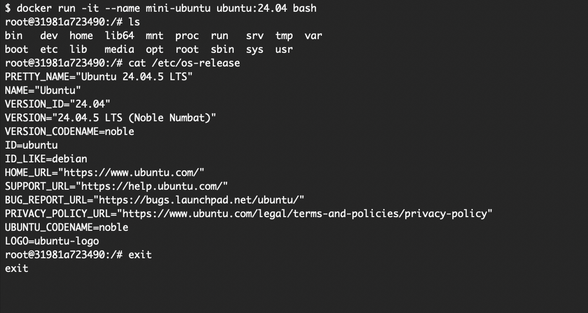

# Week 6 Part 1 — Continue with Docker containers

Previous: [Week 5 Docker basics](../../class-5/lab/part-4.md) · [Week 6 overview](../README.md) · Next: [Containerize FastAPI](part-2.md)

In Week 5, you installed Docker on `lab-5`, ran `hello-world`, and compared images with containers. This week, start with an interactive container, then package a FastAPI app. There is no need to reinstall Docker or create the `student` user again.

## 1. Reconnect and check the VM

1. Open **Compute Engine → VM instances** in your module project and start the existing `lab-5` VM.
2. Record its **current external IP**. Its ephemeral IP can change after a stop/start.
3. Check that **Allow HTTP traffic** is still enabled as in [Week 5 Part 1](../../class-5/lab/part-1.md#2-configure-the-vm). Later tutorials publish the API on VM port `80`; no new database port is needed.
4. Connect using the VM row's **SSH** button and [switch to the existing `student` user](../../class-5/lab/part-2.md#5-reconnect-using-the-existing-user). Cloud Shell is an [optional connection route](../../class-5/lab/part-2.md#optional--connect-through-cloud-shell); it is a separate environment until SSH connects to your VM.

Run these commands in the **VM's SSH terminal**:

```bash
hostname -s
whoami
id -nG
docker --version
docker ps
```

Expect `lab-5`, `student`, a group list containing `docker`, a Docker version, and a container table, which may be empty. `docker ps` must work without sudo; the version command alone does not verify access to the Docker service.

<details>
<summary>🟨 Common pitfalls</summary>

- **The hostname or user is different.** Open SSH from the `lab-5` row in Compute Engine, then run `su - student`. Use that session for the remaining commands.
- **`docker ps` reports permission denied.** Check whether `id -nG` lists `docker`. Follow the [Week 5 Docker access steps](../../class-5/lab/part-4.md#4-give-your-lab-user-access), then open a fresh `student` login to pick up group membership.
- **Docker cannot connect to its daemon.** Run `sudo systemctl status docker --no-pager`. If the service is installed but inactive, start it with `sudo systemctl start docker`. If `docker` is missing, follow the [Week 5 installation steps](../../class-5/lab/part-4.md#3-install-and-start-docker).

</details>

## 2. Pull and run an Ubuntu container

Pull a tagged image from Docker Hub:

```bash
docker pull ubuntu:24.04
```

`ubuntu` is the image repository and `24.04` is its tag. Pulling this public image does not require a Docker Hub account. An image is the template; the next command creates a container from it:

```bash
docker run -it --name mini-ubuntu ubuntu:24.04 bash
```

`-it` provides an interactive terminal, `--name` names the container, and `bash` starts its shell. A prompt such as `root@31981a723490:/#` shows that you are **inside the container**. Run:

```bash
ls
cat /etc/os-release
```



*The shell prompt includes the container ID. The release file shows Ubuntu 24.04.*

The container has its own filesystem and processes but shares the VM's Linux kernel. Run the Docker service and lab user commands on the VM.

<details>
<summary>🟨 Common pitfalls</summary>

- **The name `mini-ubuntu` is already in use.** Check `docker ps -a`. Reopen your stopped container with `docker start -ai mini-ubuntu`, or reconnect to the shell of your running container with `docker attach mini-ubuntu`.
- **The container disappears from `docker ps` after `exit`.** Use `docker ps -a` to see the stopped container and its exit status.

</details>

## 3. Exit, restart, and clean up

Leave the container shell:

```bash
exit
```

This stops the container because its main process, Bash, has finished. It returns you to the VM shell; it does not stop `lab-5`. Check the stopped container:

```bash
hostname -s
whoami
docker ps -a
```

Expect to be back on `lab-5` as `student`. Start the **same** stopped container again:

```bash
docker start -ai mini-ubuntu
```

`-a` attaches its output and `-i` allows keyboard input. Run `exit` again, then remove only your stopped practice container:

```bash
docker rm mini-ubuntu
docker ps -a
cd ~
```

The `ubuntu:24.04` image remains available. `docker run` creates a new container; `docker start` restarts an existing one.

### Checkpoint

- [ ] You are `student` on `lab-5` and `docker ps` works without sudo.
- [ ] You recorded the current external IP and checked the existing HTTP setting.
- [ ] You entered an Ubuntu container, exited it, and restarted the same container.
- [ ] You removed `mini-ubuntu` and returned to the VM shell.

Continue to [Part 2 — Containerize a FastAPI app](part-2.md). Keep the VM running while you continue. If pausing, stop `lab-5` in the Cloud Console and keep its disk and saved work; closing SSH alone does not stop it.
