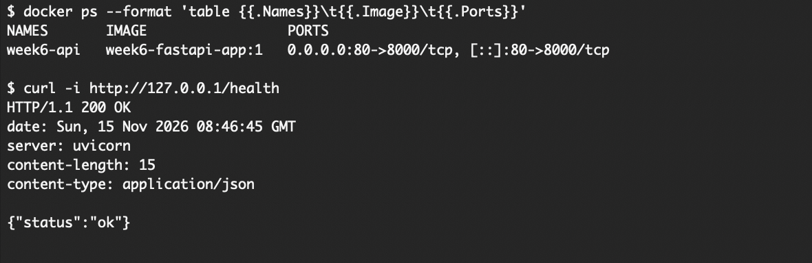
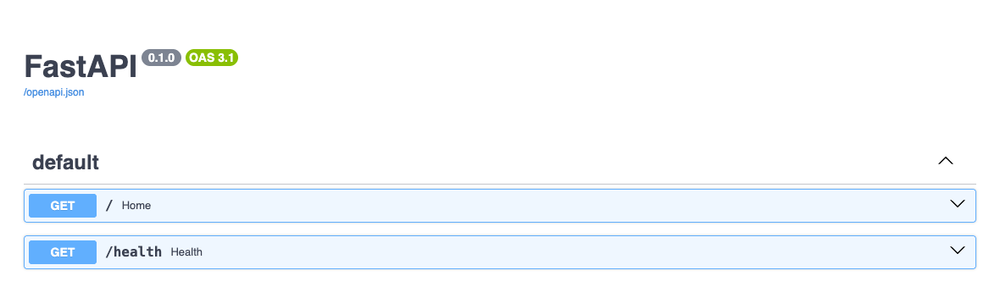

# Week 6 Part 2 — Containerize a FastAPI app

Previous: [Docker containers](part-1.md) · [Week 6 overview](../README.md) · Next: [SQLite and Docker](sqlite-and-docker.md)

Build a small FastAPI image and run it on your existing `lab-5` VM. All terminal commands below run in the **VM's SSH terminal as `student`**. Browser and Postman checks run on your own computer, using the VM's current external IP from [Part 1](part-1.md).

## 1. Create the application

Start from your home directory:

```bash
cd ~
mkdir -p week6-fastapi-docker
cd week6-fastapi-docker
pwd
```

Expect `/home/student/week6-fastapi-docker`. If you already completed the SQLite tutorial, substitute `week6-fastapi-retry` for `week6-fastapi-docker` in this part to preserve your database application's source files. The Dockerfile will install Python packages inside the image.

Create `requirements.txt` with pico:

```bash
pico requirements.txt
```

Add the same package versions used in earlier labs:

```text
fastapi==0.141.1
uvicorn==0.52.4
```

Save with **Ctrl+O → Enter**, then exit with **Ctrl+X**. Create `main.py`:

```bash
pico main.py
```

Add and save:

```python
from fastapi import FastAPI

app = FastAPI()


@app.get("/")
def home():
    return {"message": "Hello from FastAPI inside Docker"}


@app.get("/health")
def health():
    return {"status": "ok"}
```

`GET /` returns a welcome message. `GET /health` provides a simple check that the API is alive. This is normal FastAPI code; Docker changes how it is packaged and started.

## 2. Exclude local files before building

Create `.dockerignore` in this project folder:

```bash
pico .dockerignore
```

Add and save:

```text
.venv/
venv/
.git/
__pycache__/
*.py[cod]
.env
.env.*
!.env.example
*.db
*.db-*
*.sqlite
*.sqlite-*
*.sqlite3
*.sqlite3-*
data/
```

A [`.dockerignore` file](https://docs.docker.com/build/concepts/context/#dockerignore-files) excludes matching files from the build context. It keeps local environments, Git history, real environment files, SQLite databases and their journal files, and runtime data out of the build. The exception permits a deliberately non-secret `.env.example` containing placeholders. A `.gitignore` file does not replace `.dockerignore`.

This tiny app has no secrets or database yet. Establish the exclusions now, before the later database and Docker Hub tutorials.

## 3. Write the Dockerfile

Create a file named exactly `Dockerfile`, with a capital `D` and no extension:

```bash
pico Dockerfile
```

Add and save:

```dockerfile
FROM python:3.12-slim

WORKDIR /app

COPY requirements.txt .
RUN pip install --no-cache-dir -r requirements.txt

COPY main.py .

EXPOSE 8000

CMD ["uvicorn", "main:app", "--host", "0.0.0.0", "--port", "8000"]
```

| Instruction | Purpose |
| --- | --- |
| `FROM python:3.12-slim` | Start from the official Python image with the `3.12-slim` tag. |
| `WORKDIR /app` | Create and use `/app` inside the image. |
| `COPY requirements.txt .` and `RUN pip install ...` | Copy and install the dependencies before copying application code, so Docker can reuse this layer when only the code changes. |
| `COPY main.py .` | Copy the one application file this example needs. |
| `EXPOSE 8000` | Document the container's application port; it does not publish the port. |
| `CMD [...]` | Start Uvicorn when a container using this image starts. |

`--host 0.0.0.0` makes Uvicorn listen on the container's network interfaces. Listening only on `127.0.0.1` inside the container would prevent Docker's published port from reaching it. Do not use development auto-reload for this container.

## 4. Build the image

From the project folder you created in Step 1, run:

```bash
docker build -t week6-fastapi-app:1 .
docker image ls week6-fastapi-app:1
```

The final `.` selects the current project folder as the build context. `week6-fastapi-app` is the image name and `1` is its tag. Wait for the build to succeed and check that the image is listed before continuing.

<details>
<summary>🟨 Common pitfalls</summary>

- **Docker cannot find the Dockerfile or a file named in `COPY`.** Run `pwd` and `ls -la Dockerfile requirements.txt main.py .dockerignore` to check the folder and exact filenames. Include the final `.` when you rebuild.
- **The image appears in the list even though this build failed.** Docker can retain an image from a previous successful build. Fix the first error in the latest build output and run the build again.

</details>

## 5. Run and check the container on the VM

Inspect existing containers first:

```bash
docker ps -a
```

Use VM port `80` for one lab web container at a time. If you are repeating this part, [stop and remove your earlier `week6-api`](#8-stop-and-remove-this-container) before creating another with that name. If `courses-api` from the SQLite tutorial is running, use `docker stop courses-api` to free the port and keep its saved data. You can start it again after removing `week6-api`.

```bash
docker run -d --name week6-api -p 80:8000 week6-fastapi-app:1
docker ps
```

`-d` runs in the background, `--name` names the container, and `-p 80:8000` publishes **VM port 80 → container port 8000**. The existing Google Cloud HTTP rule allows traffic to VM port 80. No rule for VM port 8000 is needed. See [Docker's port-publishing explanation](https://docs.docker.com/get-started/docker-concepts/running-containers/publishing-ports/).

Check the API from the **VM terminal**:

```bash
curl --retry 10 --retry-all-errors --retry-delay 1 -i http://127.0.0.1/health
docker logs week6-api
```

Expect an HTTP `200` response and:

```json
{"status":"ok"}
```

Docker can publish the port before Uvicorn starts listening. The retry flags give the API time to start if the first request is refused or reset. Check the logs if the API still fails to respond. In the SSH terminal, `127.0.0.1` reaches the VM itself. If `curl` is missing, run `sudo apt update` and then `sudo apt install curl`.



*The container publishes VM port 80 to container port 8000. The health endpoint responds with HTTP 200.*

## 6. Test from your computer

In your computer's browser, replace `YOUR_VM_EXTERNAL_IP` with the VM's **current** external IP:

| URL | Expected result |
| --- | --- |
| `http://YOUR_VM_EXTERNAL_IP/` | HTTP `200` and the welcome message. |
| `http://YOUR_VM_EXTERNAL_IP/health` | HTTP `200` and `{"status":"ok"}`. |
| `http://YOUR_VM_EXTERNAL_IP/docs` | FastAPI's interactive API documentation. |

Use `http`, without `https` or `:8000`: Docker publishes the app on HTTP's default port `80`. Your laptop's `127.0.0.1` refers to your laptop, so use the VM's external IP in its browser.

In Postman on your computer, send `GET` requests to the first two URLs. Confirm both the `200` status and their JSON bodies. Save any screenshot you need for your lab notes before cleanup.



*The `/docs` page lists the two endpoints in this image.*

## 7. Diagnose a failed check

<details>
<summary>🟨 Common pitfalls</summary>

- **The new container exited or the VM-side request fails.** Run `docker ps -a` and `docker logs week6-api`. Check that Uvicorn listens on `0.0.0.0:8000` and the run command uses `-p 80:8000`.
- **The container name or port is already in use.** Use `docker ps -a` to identify your earlier lab container. Stop it if it is running. Remove your old or failed `week6-api` with `docker rm week6-api` before reusing that name. If no container explains the port conflict, ask the tutor to help identify the host process.
- **The VM-side request works and your browser still fails.** Copy the current external IP from the VM row. Use `http://YOUR_VM_EXTERNAL_IP/health` and check the VM's **Allow HTTP traffic** setting. If your browser changes the URL to HTTPS, use Postman with the explicit HTTP URL.
- **An edit to `main.py` never appears in the response.** Rebuild the image, stop and remove the old container, then create a new container from the rebuilt image.

</details>

## 8. Stop and remove this container

Run in the VM terminal:

```bash
docker stop week6-api
docker rm week6-api
docker ps -a
```

Confirm `week6-api` is gone and VM port 80 is free for the next tutorial. Keep the `week6-fastapi-app:1` image and project files; removing a container does not remove its image.

### Checkpoint

- [ ] The project has `main.py`, `requirements.txt`, `.dockerignore`, and `Dockerfile`.
- [ ] The image builds and the container starts successfully.
- [ ] VM-side curl, your browser, and Postman return the expected responses.
- [ ] You can explain the host/container port mapping and the purpose of `.dockerignore`.
- [ ] You stopped and removed `week6-api` before continuing.

Continue to [SQLite and Docker](sqlite-and-docker.md). Keep the VM running while you continue; stop it in the Cloud Console if pausing.
