# Week 7 Lab 1 — Deploy FastAPI on Kubernetes with GKE

[Week 7 overview](../README.md) · [Week 6 Docker lab](../../class-6/README.md)

Deploy a small FastAPI app, test it, run two copies and publish an update. By the end you should be able to follow an image from the Dockerfile to a running Pod and explain how a browser request reaches FastAPI.

In Week 6 you ran `docker build`, `docker tag` and `docker push` on a VM. Here **Cloud Build** builds an image from the supplied Dockerfile, tags it and pushes it to **Artifact Registry**. Artifact Registry is Google's image registry, the counterpart to Docker Hub in this lab. **Kubernetes** pulls that image and keeps the application running according to your YAML files.

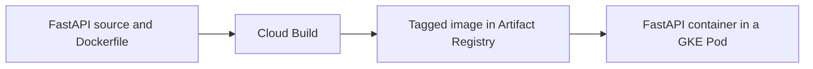

| Term | What it means in this lab |
| --- | --- |
| Cluster | The control plane that decides what should run, plus one or more worker machines that run it. Google Kubernetes Engine (GKE) manages the control plane. |
| Node | A worker machine. Your Standard cluster starts with one VM in one zone. |
| Pod | The unit Kubernetes runs on a node. Each FastAPI Pod in this lab holds one container. |
| Deployment | Tells Kubernetes which image to run and how many copies, called replicas, to maintain. |
| Service | Gives clients a stable address and finds matching Pods by label, even as Pods are replaced. |

Use the **Google Cloud Console** for the browser steps and **Cloud Shell** for the commands. Cloud Shell is the terminal in the Console, with `gcloud` and `kubectl` already installed. `gcloud` works with Google Cloud resources. `kubectl` works with the Kubernetes cluster you connect it to. Check the project picker when following a Console link.

Use the names from your own project throughout the lab. The screenshots show a demonstration project. The cluster, its worker and the optional public endpoint can use cloud credit; leave time for [cleanup](#9-clean-up).

## 1. Select your project and enable the APIs

1. Open the Google Cloud Console and use the project picker at the top to select your course project. Record its **Project ID**, which may differ from the display name. [Open the Google Cloud Console](https://console.cloud.google.com/).
2. Choose a short suffix unique to you in this project, such as `alex417`. Use lowercase letters and numbers. With that suffix, your repository will be `lab7-containers-alex417` and your cluster will be `lab7-gke-alex417`. Record your two names so you can find them during cleanup.
3. Open **APIs & Services → Library**. An API lets tools such as the Console and `gcloud` use a Google Cloud service. Search for **Compute Engine API**, **Kubernetes Engine API**, **Artifact Registry API** and **Cloud Build API**. Open each result and click **Enable**. If you see **Manage**, the API is already enabled. [Open the API Library](https://console.cloud.google.com/apis/library).

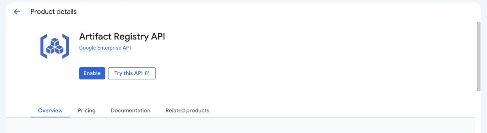

*Use **Enable** here for Artifact Registry and repeat for the other three APIs.*

If the project is missing or enabling an API fails, check the signed-in Google account and project picker. Ask your tutor to check your access or billing if the error persists.

## 2. Create the Docker repository

Go to **Artifact Registry → Repositories**, click **Create repository** and enter the settings below. Replace `YOUR_SUFFIX` with your own suffix, then click **Create**. [Open Artifact Registry](https://console.cloud.google.com/artifacts).

| Setting | Value |
| --- | --- |
| Name | `lab7-containers-YOUR_SUFFIX` |
| Format | **Docker** |
| Mode | **Standard** |
| Location type | **Region** |
| Region | **europe-west1 (Belgium)** |

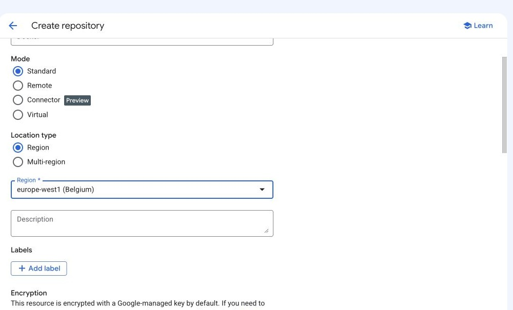

*Use a regional Docker repository in `europe-west1`. The screenshot shows the demonstration project.*

Confirm your repository appears in the list. It will hold the image that GKE pulls later. If the name already exists, check whether it is your own lab repository and confirm its format and region before reusing it.

## 3. Create and connect to a GKE Standard cluster

1. Open **Kubernetes Engine → Clusters** and click **Create**. In **Create a cluster**, click **Configure** beside **Standard: You manage your cluster**. [Open GKE clusters](https://console.cloud.google.com/kubernetes/list).

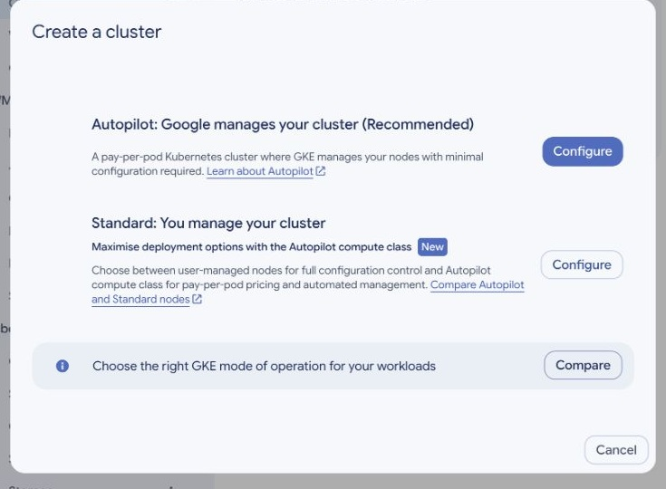

2. Under **Cluster basics**, set the name to `lab7-gke-YOUR_SUFFIX`. Set **Location type** to **Zonal**, choose `europe-west1-b` and use the **Regular** release channel. A region is an area such as `europe-west1`. A zone is a location inside it such as `europe-west1-b`. Keep **Default node locations** set to **Default** so the nodes use this zone.

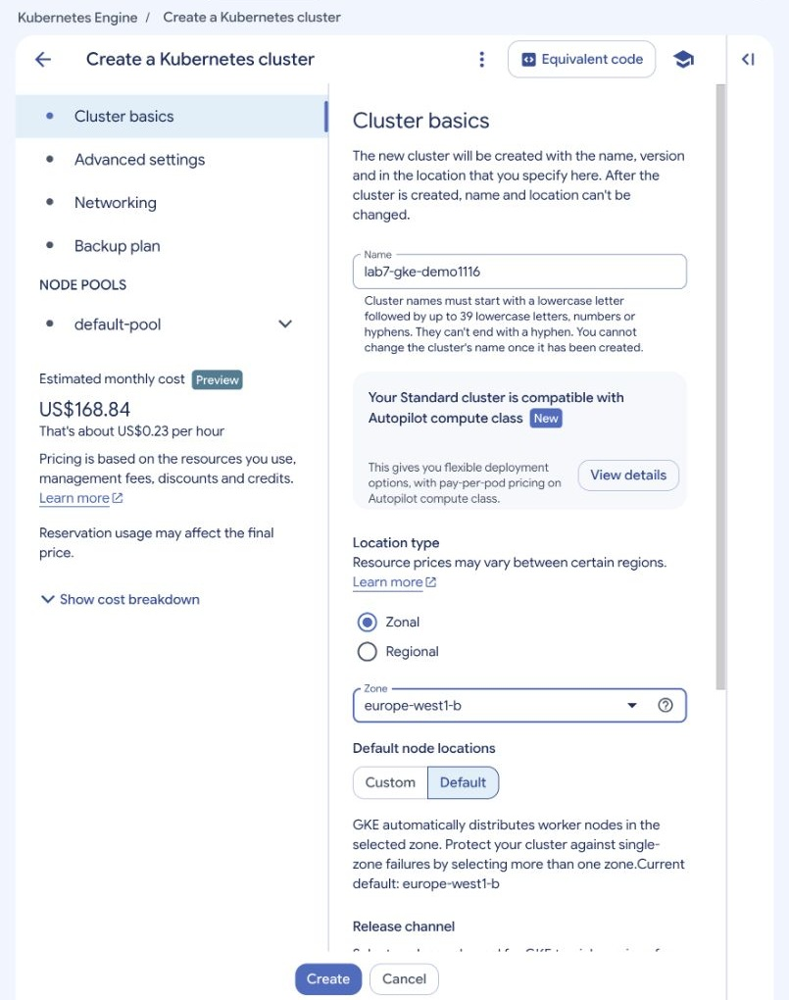

3. Under **Node Pools → default-pool**, set **Number of nodes** to **1**. Keep **Enable cluster auto-scaler** unchecked and **Node pool default node locations** set to **Cluster default**. This pool is the group of worker nodes that share the same configuration.

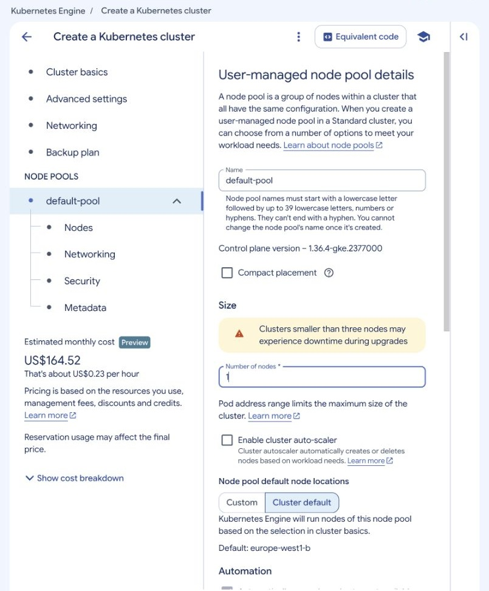

4. Open **default-pool → Nodes**. In **Machine configuration** choose the **E2** series under **General purpose**. In **Machine type**, choose **e2-standard-2** from the **Standard** group. Set **Boot disk type** to **Balanced persistent disk** and **Boot disk size (GB)** to **30**.

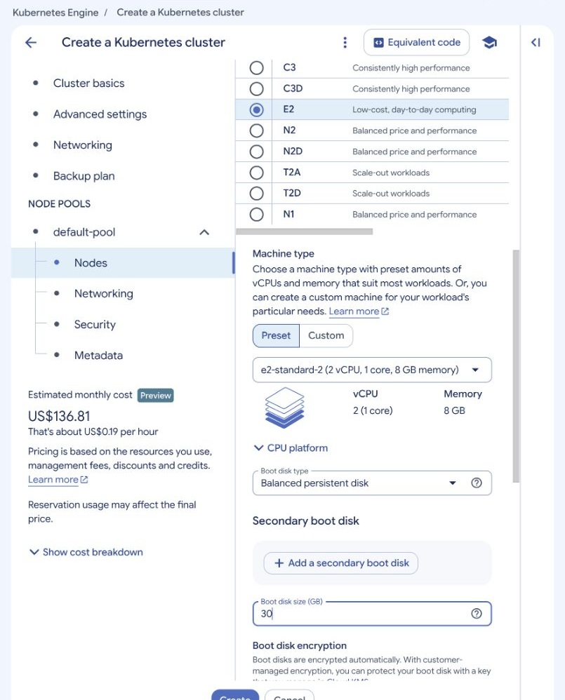

5. Use the **default** network if it is available for your course project, or follow the network settings supplied by your tutor. Keep the remaining defaults and click **Create**. [Google's zonal cluster documentation](https://docs.cloud.google.com/kubernetes-engine/docs/how-to/creating-a-zonal-cluster).

Wait for the cluster's status to show a green check mark. This can take several minutes. Check the cluster name, zone and node count in the list. You can open the cluster details to check that the mode is **Standard**.

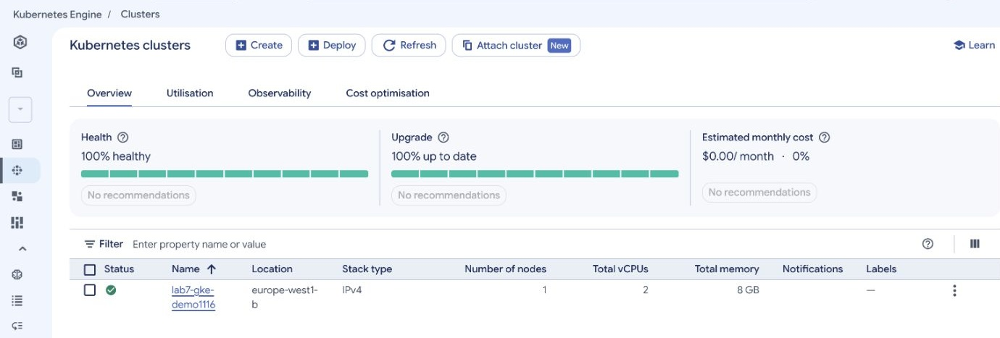

*Find your own lab cluster by the name you recorded.*

On your cluster's row, open **⋮ → Connect** and click **Run in Cloud Shell**. If the terminal does not open, copy the generated command, click **Activate Cloud Shell** in the top toolbar and paste it there. Press **Enter** to run it. If Cloud Shell asks you to authorise access, click **Authorize**. The command retrieves connection details for your project, zone and cluster and stores them in the configuration used by `kubectl`.

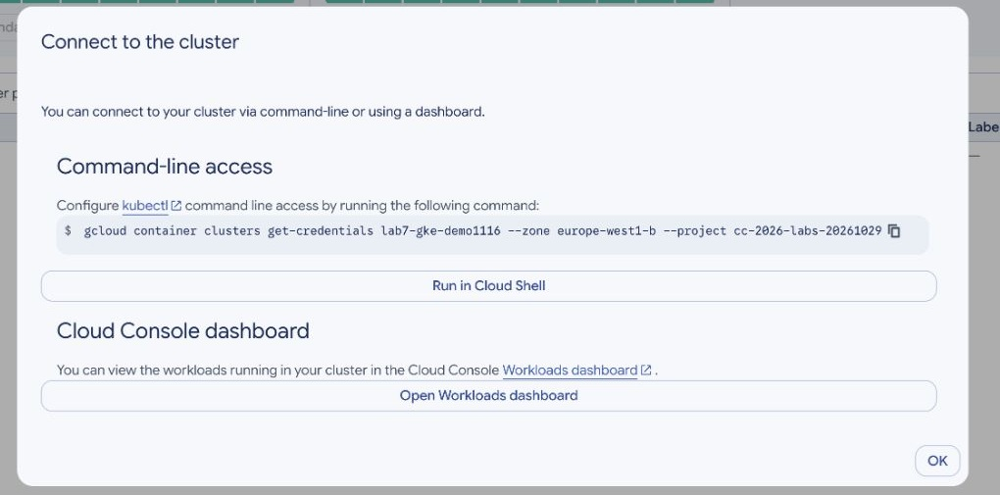

*Use the command generated for your cluster. Its project ID, zone and cluster name identify the target. If you copy the command by hand, leave out the leading `$`; it represents the terminal prompt.*

In that Cloud Shell tab, run:

```bash
kubectl config current-context
kubectl get nodes
```

The first command should show your project ID, zone and cluster name. The second contacts the cluster and should list one worker with status `Ready`. After confirming the target, set the context to use `default`, the namespace or group of Kubernetes resources used throughout this lab:

```bash
kubectl config set-context --current --namespace=default
```

Use the same Cloud Shell terminal for the following steps.

<details>
<summary>Common pitfalls</summary>

- **The command shows a different cluster.** Return to your cluster row and repeat **Connect → Run in Cloud Shell**. Check the context before applying any files.
- **Cluster creation fails.** Read the actual error. Check the region, zone, billing and that the default pool has one node. Ask your tutor about a permission, network or quota error before trying other settings.
- **The Cloud Shell panel disconnects.** Click **Reconnect** and run the Connect command again if needed. Return to your lab folder before running file-based commands.

</details>

## 4. Build and deploy FastAPI

### Open the lab files

Run these commands in Cloud Shell. They clone the course source into a folder called `week7-cc` in your Cloud Shell home directory.

```bash
cd ~
git clone --depth 1 https://github.com/warestack/cc.git week7-cc
cd ~/week7-cc/class-7/lab
pwd
ls -a app/ k8s/
```

The output should list `main.py`, `Dockerfile` and `requirements.txt` in `app/`, and `deployment.yaml` and `service.yaml` in `k8s/`. If your tutor gave you a GitHub branch for this lab, add `--branch BRANCH_NAME` after `--depth 1`, substituting that branch's name. If you are resuming this attempt, skip the clone and return to your existing lab folder. If you are starting again and `week7-cc` already exists, use a fresh folder name such as `week7-cc-retry` in the clone and `cd` commands.

Open [`app/main.py`](app/main.py) and [`app/Dockerfile`](app/Dockerfile) in the repository or Cloud Shell Editor. The first `@app.get(...)` route handles `GET /` and the second handles `GET /health`. FastAPI turns the Python dictionaries into JSON and provides interactive documentation at `/docs`. The Dockerfile installs the pinned Python dependencies, copies the application and starts Uvicorn listening on `0.0.0.0:8080` inside the container. Compare its structure with the Week 6 Dockerfile. [Week 6 Dockerfile walkthrough](../../class-6/lab/part-2.md#3-write-the-dockerfile).

### Build and publish version 1

Replace `your-project-id` and `lab7-containers-your-suffix` below with the exact values you recorded. Keep the rest of the block as written. These variables are values for this terminal session. Set them again if you start a new session.

```bash
PROJECT_ID=your-project-id
REPOSITORY=lab7-containers-your-suffix
REGION=europe-west1
IMAGE_BASE="${REGION}-docker.pkg.dev/${PROJECT_ID}/${REPOSITORY}/fastapi"
printf '%s\n' "${IMAGE_BASE}:v1"
```

The printed reference contains a registry hostname, your project ID, your repository, the image name `fastapi` and the tag `v1`. Save it for the Deployment. This plays the same role as `USERNAME/week6-courses-api:1` did on Docker Hub. The tag is a readable version name. The digest identifies the exact published image. [Week 6 image names and tags](../../class-6/lab/docker-hub.md#1-understand-image-names).

From `class-7/lab`, upload the `app/` build context to Cloud Build:

```bash
gcloud builds submit ./app --tag="${IMAGE_BASE}:v1" \
  --project="$PROJECT_ID" --region="$REGION"
```

Wait for `SUCCESS`. The build uses `app/Dockerfile` and publishes the result under the full tag. You can find its build ID and status in **Cloud Build → History**. In **Artifact Registry → Repositories**, open your repository, select **fastapi** and find `v1` in the **Tags** column. Open the version in that row to see its full `sha256:…` digest. Record the image reference and digest, as you did in Week 6.

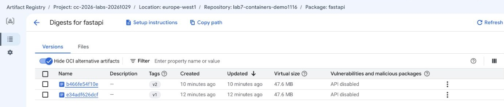

*The completed demonstration shows both tags. At this stage, your own repository needs `v1`. You build `v2` in step 7.*

### Configure and apply the manifests

A Kubernetes manifest is a YAML file declaring the configuration you want. Review the two files before you apply them.

| File | What to look for |
| --- | --- |
| [`k8s/deployment.yaml`](k8s/deployment.yaml) | `replicas: 1` requests one Pod. The Pod template supplies the image and the label `app: fastapi`. The readiness probe checks `/health` before the Pod receives Service traffic. If the liveness check fails repeatedly, Kubernetes restarts the container. |
| [`k8s/service.yaml`](k8s/service.yaml) | The `ClusterIP` Service has an internal address. The selector `app: fastapi` matches the Pod label. The Service listens on port `80` and forwards to the named `http` port, which is `8080` in the Deployment. |

In the Cloud Shell toolbar, click **Open Editor** (it may be labelled **Editor**). Use the Explorer to open the `week7-cc/class-7/lab` folder from your home directory. If needed, use **File → Open Folder**. Open `k8s/deployment.yaml`, replace only `LAB7_IMAGE` with your full image reference ending in `/fastapi:v1`, and save. Leave the indentation and `replicas: 1` as they are. Your line will have this form, with your own project and repository:

```yaml
          image: europe-west1-docker.pkg.dev/YOUR_PROJECT_ID/YOUR_REPOSITORY/fastapi:v1
```

Return to the Cloud Shell terminal. From `class-7/lab`, check the context and the saved image line before applying both files.

```bash
kubectl config current-context
grep 'image:' k8s/deployment.yaml
```

If the context is your cluster and the image points to your repository, continue:

```bash
kubectl apply -f k8s/
kubectl rollout status deployment/fastapi --timeout=10m
kubectl get pods -l app=fastapi
kubectl get service fastapi
```

Expect a successful rollout, one Pod with `1/1` and `Running`, and a `ClusterIP` Service named `fastapi` with port `80/TCP`. Open **Kubernetes Engine → Workloads** and find the `fastapi` Deployment on your cluster in the `default` namespace. The **Pods** column should show **1/1**.

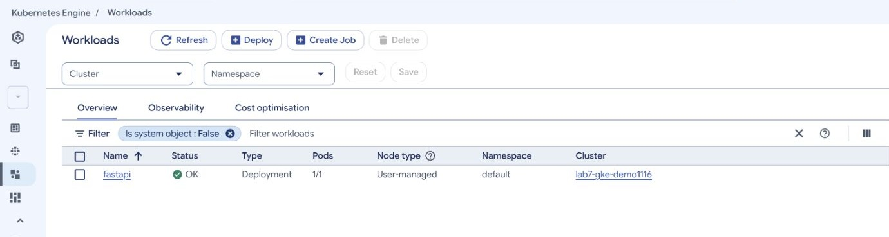

*The Workloads page shows one ready replica out of one requested.*

<details>
<summary>Common pitfalls</summary>

- **Cloud Build reports a failed upload or push.** Check the project ID, region and repository name. Open the build in **Cloud Build → History** if it has a build ID and read the first error. Ask your tutor to check source upload, build service account or Artifact Registry permissions if the error says permission denied. [Cloud Build troubleshooting](https://docs.cloud.google.com/build/docs/troubleshooting).
- **The terminal reports a log streaming error.** Check **Cloud Build → History** for the actual build result and continue after the build succeeds and the tag appears.
- **The Pod is Pending, shows ImagePullBackOff, or keeps restarting.** Run `kubectl describe pods -l app=fastapi` and read **Events** near the bottom. Check node readiness for a scheduling error. For an image pull error, compare the image line with the registry tag exactly. Ask your tutor to check the GKE node service account's registry access if the event says permission denied. For a restart, run `kubectl logs deployment/fastapi` and look for a startup error.
- **The Editor cannot find the file.** From `class-7/lab`, use `cloudshell edit k8s/deployment.yaml` to open it directly. Save before applying.

</details>

## 5. Test the API in your browser

In Week 6, Docker's `-p 80:8000` mapped the VM's port `80` to the container's port `8000`. This week, the internal Service maps port `80` to the FastAPI container's port `8080`. Open a temporary tunnel from Cloud Shell to check the app before you give it a public address.

| Where | Port | What it does |
| --- | --- | --- |
| Cloud Shell | `8080` | Receives the browser requests from Web Preview. |
| Kubernetes Service | `80` | The port you give to `kubectl port-forward` when naming the Service. |
| FastAPI container | `8080` | The destination port where Uvicorn handles the request. |

```bash
kubectl port-forward service/fastapi 8080:80
```

Leave this command running. Here `8080:80` means **Cloud Shell port 8080 → Service port 80**. Kubernetes uses the Service to select one Pod and forwards the tunnel to that Pod's `8080` port.

1. In the Cloud Shell toolbar, click **Web Preview → Preview on port 8080**. This opens a new browser tab through Google's preview proxy.
2. Check the response at the base URL. It should contain `{"message":"Hello from FastAPI on Kubernetes"}`. Set the URL path to `/health`, keeping the same hostname, and check for `{"status":"ok"}`.
3. Replace `/health` with `/docs`, expand **GET /health**, then click **Try it out → Execute**. Confirm the status code is `200` and the response body contains `"status": "ok"`.

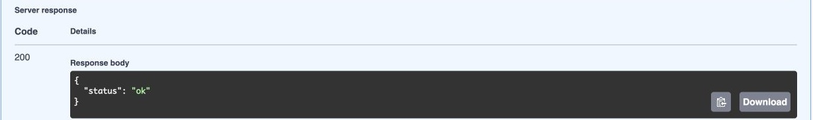

*The documentation shows the response code and JSON body. Your Web Preview address is specific to your Cloud Shell session.*

Capture the result for your lab notes, then return to the Cloud Shell terminal and press **Ctrl+C** to stop the tunnel. The Pods and Service will keep running.

<details>
<summary>Common pitfalls</summary>

- **The browser preview fails.** Check that the port-forward is still running. If its Pod was replaced, wait for a ready Pod and run the forward again. If you open a second terminal tab from the same Cloud Shell toolbar, you can check directly with `curl -i http://127.0.0.1:8080/health`.
- **The preview menu is missing.** In a second Cloud Shell terminal tab, run `printf 'https://8080-%s/docs\n' "$WEB_HOST"` and open the printed address while the forward runs. [Cloud Shell preview URLs](https://docs.cloud.google.com/shell/docs/using-web-preview).
- **Port 8080 is in use.** Stop a previous port-forward, or run `kubectl port-forward service/fastapi 8081:80` and select **Web Preview → Change port** to enter `8081`.

</details>

## 6. Scale to two replicas

In Cloud Shell Editor open `k8s/deployment.yaml`. Change the existing `replicas: 1` under the Deployment's `spec` to `replicas: 2` and save. Keep the `v1` image reference in place.

```yaml
spec:
  replicas: 2
```

Reapply the Deployment and check it:

```bash
kubectl apply -f k8s/deployment.yaml
kubectl rollout status deployment/fastapi --timeout=10m
kubectl get pods -l app=fastapi -o wide
kubectl get endpointslices -l kubernetes.io/service-name=fastapi
```

Both Pods should be `Running` with `1/1` under `READY`. The `-o wide` output shows each Pod's IP and worker node. Both Pods can run on the same worker in this lab. **Horizontal scaling** adds application replicas. This exercise leaves the worker count at one.

The EndpointSlice output should include both Pod IPs under `ENDPOINTS`. EndpointSlices track the addresses and availability of Pods for a Service. Compare the addresses with the preceding Pod output. If you see only one address, wait a few seconds and run the EndpointSlice command again. A browser refresh through the port-forward still goes to the single Pod selected for that tunnel.

Refresh **Kubernetes Engine → Workloads** and check **2/2** in the **Pods** column for `fastapi`.

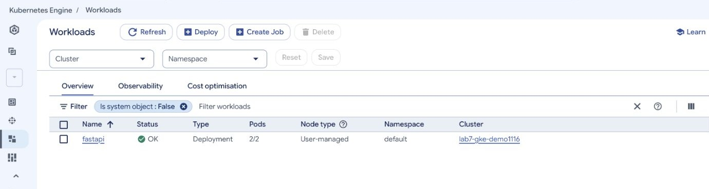

*The same Deployment now shows two ready replicas out of two requested.*

If the count stays at one, check that you saved and applied the same manifest. For a Pod that stays Pending, run `kubectl describe pods -l app=fastapi` and check **Events** for the scheduling reason.

If you chose practice option A, do the [Pod replacement exercise](exercise.md) now, while your two replicas are running. Then return for the version 2 update.

## 7. Roll out version 2

1. In Cloud Shell Editor, open `app/main.py`. In the `home()` function, change the return line as shown and save the file.

   ```python
       return {"message": "Hello from FastAPI v2 on Kubernetes"}
   ```

2. From `class-7/lab`, build and publish with a new tag. If you opened a new terminal, set the variables from [step 4](#build-and-publish-version-1) first.

```bash
gcloud builds submit ./app --tag="${IMAGE_BASE}:v2" \
  --project="$PROJECT_ID" --region="$REGION"
```

Wait for `SUCCESS` and confirm that Artifact Registry shows `v2`. In `k8s/deployment.yaml`, change the image tag from `:v1` to `:v2`, keep `replicas: 2`, and save. Apply and check the update:

```bash
kubectl apply -f k8s/deployment.yaml
kubectl rollout status deployment/fastapi --timeout=10m
kubectl get replicasets -l app=fastapi
kubectl describe deployment fastapi
```

The default **RollingUpdate** strategy adds Pods with the new image and retires the old Pods as the replacement becomes ready. The ReplicaSets, which manage groups of matching Pods for each revision, should show the new one with two ready replicas and the old one with zero. Check the `Image:` line in the Deployment output for `:v2`.

Restart the port-forward and open Web Preview again:

```bash
kubectl port-forward service/fastapi 8080:80
```

The base URL now returns `{"message":"Hello from FastAPI v2 on Kubernetes"}`. Use `/docs` to check that `GET /health` still returns `200` with `{"status":"ok"}`. Capture the changed response and stop the tunnel with **Ctrl+C**.

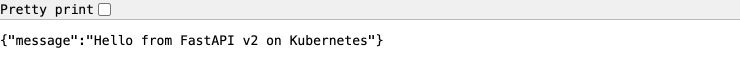

If you see the old message, check the `v2` build status, the saved image tag and the rollout result. Start a fresh tunnel after the rollout completes. If you used `8081` in step 5, you can reuse that port for the tunnel and preview here.

## 8. Try a public LoadBalancer

Do this exercise if your course project permits a public load balancer. A `LoadBalancer` Service asks GKE to provision a Google Cloud load balancer with an external IP. Anyone who can reach that IP can call this demo API over HTTP. Use the supplied app and remove the public Service after testing.

Create a second Service that selects the same two Pods. It publishes port `80` and uses port `8080` in the containers:

```bash
kubectl expose deployment fastapi --name=fastapi-public \
  --type=LoadBalancer --port=80 --target-port=8080
kubectl get service fastapi-public --watch
```

Wait for a value in `EXTERNAL-IP` and press **Ctrl+C** to stop watching. In the Cloud Console, open **Kubernetes Engine → Networking → Gateways, Services and Ingress** and select the **Services** tab. Find `fastapi-public` on your cluster. Its row should show **External load balancer**, an address under **Endpoints** and **2/2** under **Pods**.

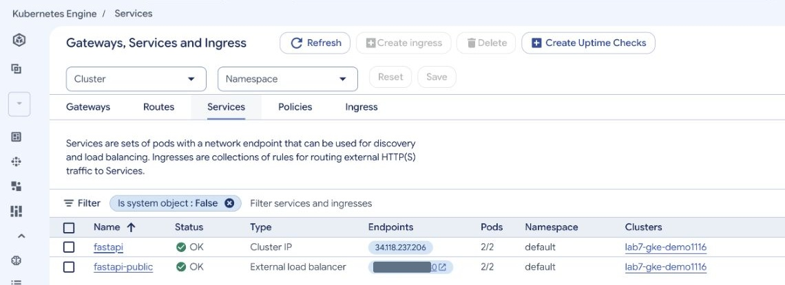

*The demonstration IP is obscured. Use the external IP in your own Service row or in the terminal's `EXTERNAL-IP` column.*

In a browser tab, visit `http://EXTERNAL_IP/` and `http://EXTERNAL_IP/health`, using your Service's actual IP. You should see the version 2 message and then `{"status":"ok"}`. Use `http://`. If the browser forces HTTPS, check via Cloud Shell while substituting your real IP in the command:

```bash
curl -i --max-time 10 http://EXTERNAL_IP/health
```

Expect HTTP `200`. This request works without a port-forward because the public address belongs to the load balancer. Both Pods return identical responses, so use their logs to see which one served each request.

If the IP remains `<pending>` after several minutes, check **Events** in the Service details or run `kubectl describe service fastapi-public`. A public address can be blocked by policy or quota. If the IP appears but requests time out, wait briefly for the load balancer to finish setting up and retry over HTTP.

<details>
<summary>See how requests reach the two Pods (optional)</summary>

In Cloud Shell, replace `your-external-ip` with the Service's actual IPv4 address. Run the block in one terminal. The loop makes 20 separate HTTP requests. Each URL includes a marker you can find in the access logs.

```bash
EXTERNAL_IP=your-external-ip
RUN_ID=$(date +%s)

for request in {1..20}; do
  curl --fail --silent --show-error --max-time 10 \
    --output /dev/null --write-out '%{http_code}\n' \
    "http://${EXTERNAL_IP}/health?lab7-check=${RUN_ID}-${request}"
done
```

Expect 20 lines that each say `200`. Now find this run's log entries and count them by Pod:

```bash
kubectl logs -l app=fastapi --prefix=true --tail=-1 \
  | grep -F "lab7-check=${RUN_ID}-" \
  | awk '{print $1}' \
  | sort | uniq -c
```

Each line shows a request count and a Pod name. The demonstration returned HTTP `200` for all 20 requests. One Pod handled 13 and the other handled 7. Your split can differ. A single successful response shows the public endpoint works. The log counts show which Pods handled the batch.

</details>

After collecting evidence, delete the public Service even if it is still pending. Wait for deletion to complete before deleting the cluster.

```bash
kubectl delete service fastapi-public --wait=true --timeout=10m
kubectl get services
```

## 9. Clean up

Save your evidence first, including the deployed image tag, the successful health check, two ready Pods and the version 2 response. If you tried the public LoadBalancer, confirm the `fastapi-public` Service is gone. If any port-forward is still running, stop it with **Ctrl+C**.

1. Confirm the Console project picker shows your course project. Open **Kubernetes Engine → Clusters**, find your lab cluster by its exact name, use **⋮ → Delete** and confirm. Wait for the cluster to disappear from the list. Deleting the cluster also removes its worker node and the Deployment and Service inside it.
2. Open **Artifact Registry → Repositories**, select only the Docker repository you created for the lab, then click **Delete** and confirm. This removes its stored images and tags.
3. Refresh both lists and confirm that your exact cluster and repository names are gone. If deletion is blocked, read the displayed error. Ask your tutor about a permission issue or turn off deletion protection if it was enabled on your disposable lab cluster.

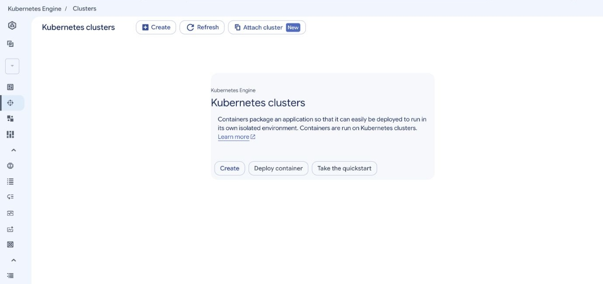

*Other clusters may remain visible in a shared project. Verify the disappearance of your exact lab cluster.*

Cloud Build can store uploaded source archives in a project staging bucket. On a shared course project, leave the bucket and enabled APIs in place. If your tutor has asked you to remove individual build archives, identify your own objects by the exact `gs://…` paths printed when you submit your builds.

### Checkpoint

- [ ] I built and published a tagged image and can find it in Artifact Registry.
- [ ] I used `kubectl` to verify the node, Deployment, Pods and Service in my lab cluster.
- [ ] I saw HTTP `200` and `{"status":"ok"}` through the Cloud Shell preview.
- [ ] I matched two Pod IPs to the Service endpoints after scaling.
- [ ] I built `v2`, completed the rollout and checked the new response in my browser.
- [ ] I can explain how a temporary preview differs from a public LoadBalancer endpoint.
- [ ] I confirmed my lab cluster, repository and any public Service are gone.

Use your saved evidence and the supplied manifests for [Homework 1](../homework/homework-1.md) after cleanup.

[Cloud Shell Web Preview](https://docs.cloud.google.com/shell/docs/using-web-preview) · [Kubernetes Deployments](https://kubernetes.io/docs/concepts/workloads/controllers/deployment/) · [Kubernetes Services](https://kubernetes.io/docs/concepts/services-networking/service/)
