# Week 7 Lab 1 — Deploy FastAPI on Kubernetes with GKE

[Week 7 overview](../README.md)

Use Google Kubernetes Engine (GKE) to run a small FastAPI app. You will build a Docker image, store it in Artifact Registry, and use `kubectl` to deploy and test it.

| Kubernetes term | What it means in this lab |
| --- | --- |
| Cluster | The control plane and the worker nodes that run your app. In GKE Autopilot, Google manages the nodes and provisions capacity as Pods need it. |
| Pod | The smallest unit Kubernetes runs. Each FastAPI Pod in this lab runs one container. |
| Deployment | Keeps the requested number of FastAPI Pods running and replaces them when you change the image. |
| Service | Gives clients one address for the app, even as the Pods behind it change. |

## 1. Open Cloud Shell and select your project

1. Sign in to the [Google Cloud console](https://console.cloud.google.com/) and select your course project. It needs billing and permissions to enable APIs, create a GKE cluster and an Artifact Registry repository, and submit Cloud Build jobs.
2. Click **Activate Cloud Shell** in the top toolbar. Wait for the terminal and choose **Authorize** if asked.
3. Use this first Cloud Shell tab for setup, deployment and cleanup. Replace `YOUR_PROJECT_ID` with the **Project ID** from the project selector. Replace `YOUR_LAB_SUFFIX` with a short identifier unique to you in the project, using lowercase letters and digits, for example `alex417`. Save the project ID, region and suffix so you can reuse them when you reconnect or clean up.

```bash
export PROJECT_ID=YOUR_PROJECT_ID
export REGION=europe-west1
export LAB_SUFFIX=YOUR_LAB_SUFFIX
export CLUSTER="lab7-gke-${LAB_SUFFIX}"
export REPOSITORY="lab7-containers-${LAB_SUFFIX}"
export IMAGE="${REGION}-docker.pkg.dev/${PROJECT_ID}/${REPOSITORY}/fastapi"

gcloud projects describe "$PROJECT_ID" --format='value(projectId)'
kubectl version --client
printf 'Cluster: %s\nRepository: %s\n' "$CLUSTER" "$REPOSITORY"
```

Check that `gcloud` prints your project ID and the names end with the suffix you chose.

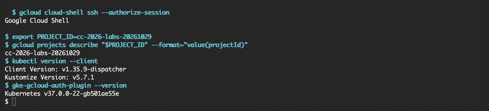

*This setup capture shows Cloud Shell over SSH. The test cluster and repository use the suffix `-1115`. Use your course project ID and the resource names you set above.*

Enable the APIs for Kubernetes, Compute Engine, Artifact Registry and Cloud Build.

```bash
gcloud services enable \
  container.googleapis.com compute.googleapis.com \
  artifactregistry.googleapis.com cloudbuild.googleapis.com \
  --project="$PROJECT_ID"

gcloud services list --enabled --project="$PROJECT_ID" \
  --filter='config.name:(container.googleapis.com compute.googleapis.com artifactregistry.googleapis.com cloudbuild.googleapis.com)' \
  --format='value(config.name)'
```

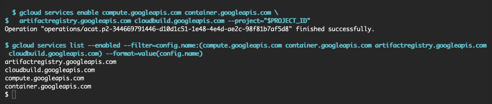

*The test project has all four lab APIs enabled.*

<details>
<summary>🟨 Common pitfalls</summary>

- **Project missing or permission denied.** Run `gcloud auth list` and `gcloud projects list` to confirm the account and project ID. If project access works but API enablement is denied, ask your course admin to enable the four APIs or grant permission to enable them.
- **New tab or a restarted shell.** Shell variables are tab-specific. Repeat the export block with the **same** project, region and suffix. If you chose a different cluster name later, restore that `CLUSTER` value too. Return to `~/week7-cc/class-7/lab` or the directory you chose. If you already created the cluster, rerun `get-credentials` from [step 3](#3-create-and-connect-to-a-gke-autopilot-cluster).

</details>

> [!WARNING]
> GKE and related services can use your cloud credit. Keep this lab's resources until you have captured your checks, then follow [Cleanup](#7-cleanup).

## 2. Build the Docker image and push it to Artifact Registry

Clone the course repo into a new folder from your Cloud Shell home directory. Use the same branch as this guide. If you are viewing a review branch, add `--branch BRANCH_NAME` to the clone command, using the name shown on GitHub. If you already have a current copy, open its `class-7/lab` directory and run the `ls` check. Use this directory for the remaining file-based commands.

```bash
cd ~
git clone --depth 1 https://github.com/warestack/cc.git week7-cc && cd week7-cc/class-7/lab
ls app/Dockerfile k8s/deployment.yaml k8s/service.yaml
```

Confirm that `ls` prints all three paths before continuing. If a path is missing, check the recovery note at the end of this step.

Open [`app/main.py`](app/main.py) and the [`Dockerfile`](app/Dockerfile). FastAPI defines `/` and `/health`. The Dockerfile installs the Python dependencies and starts Uvicorn on port `8080` inside the container. FastAPI generates interactive documentation at `/docs`.

Create a **Docker** repository in Artifact Registry. The registry stores the tagged image so GKE can pull it when starting a Pod. If creation reports that the name already exists, check the recovery note at the end of this step before building.

```bash
gcloud artifacts repositories create "$REPOSITORY" \
  --repository-format=docker \
  --location="$REGION" \
  --project="$PROJECT_ID"

gcloud artifacts repositories describe "$REPOSITORY" \
  --location="$REGION" --project="$PROJECT_ID"
```

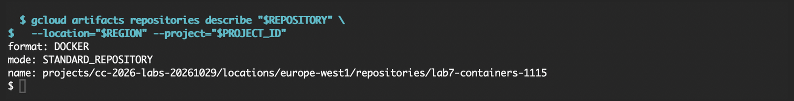

*Check for `format: DOCKER` in the repository details.*

Submit the app directory to Cloud Build. It runs the Docker build and pushes the image with the `v1` tag.

```bash
gcloud builds submit ./app \
  --tag="${IMAGE}:v1" \
  --region="$REGION" \
  --project="$PROJECT_ID"

gcloud artifacts docker images list "$IMAGE" --include-tags --project="$PROJECT_ID"
```

Wait for the build's `SUCCESS` status and check that the image list shows `v1` before continuing. If you already built `v1` in an earlier session, run the image list command to confirm the tag and continue with it.

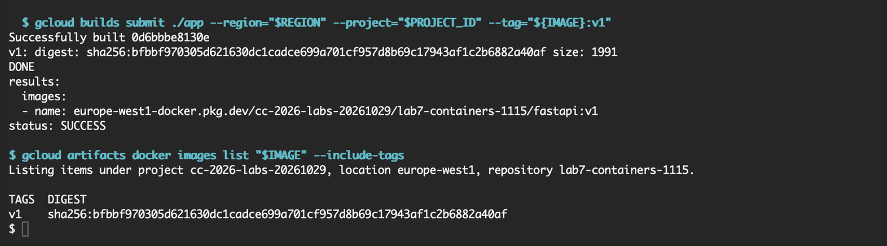

*The `v1` tag points to the image digest produced by the build.*

<details>
<summary>🟨 Common pitfalls</summary>

- **`week7-cc` already exists or `./app` is missing.** Run `cd ~/week7-cc/class-7/lab`, then `pwd` and `ls app/Dockerfile k8s/deployment.yaml`. If your checkout is on the branch containing this guide but is out of date, run `git -C ~/week7-cc pull --ff-only` and check the paths again. Use a fresh checkout in a new folder if you are reading the guide on another branch.
- **The Docker repository already exists.** Use the `describe` command above to verify its name, region and `DOCKER` format. If it belongs to you from an earlier attempt, continue. If it belongs to someone else, return to step 1, choose a different suffix and repeat its export block.
- **Cloud Build reports permission denied.** Read the first error. If submission is denied, ask your admin to check your access to submit builds or upload the source archive, depending on the error. If the build starts but cannot fetch the source or push the image, ask them to check the build service account's access. [Cloud Build troubleshooting](https://docs.cloud.google.com/build/docs/troubleshooting)

</details>

## 3. Create and connect to a GKE Autopilot cluster

Create a regional Autopilot cluster. This can take several minutes.

```bash
gcloud container clusters create-auto "$CLUSTER" \
  --location="$REGION" --project="$PROJECT_ID"

gcloud container clusters describe "$CLUSTER" \
  --location="$REGION" --project="$PROJECT_ID" \
  --format='yaml(name,location,status,autopilot.enabled)'
```

Check for `status: RUNNING` and `autopilot.enabled: true`. If creation reported an existing cluster, check the recovery note at the end of this step before connecting. You can also find the cluster under **Kubernetes Engine → Clusters** in the Google Cloud console.

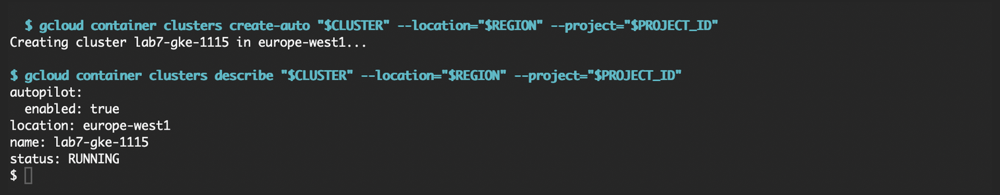

*The cluster is ready to accept `kubectl` commands.*

Connect `kubectl` by downloading the cluster connection details. The current **context** tells you which cluster your `kubectl` commands will target.

```bash
gcloud container clusters get-credentials "$CLUSTER" \
  --location="$REGION" --project="$PROJECT_ID" &&
  kubectl config set-context --current --namespace=default

kubectl config current-context
kubectl get namespaces
kubectl get nodes
```

Check that the context includes your project, region and cluster. The app uses the `default` namespace on the lab cluster. Autopilot may report `No resources found` for nodes before you deploy. It provisions nodes when workloads need them.

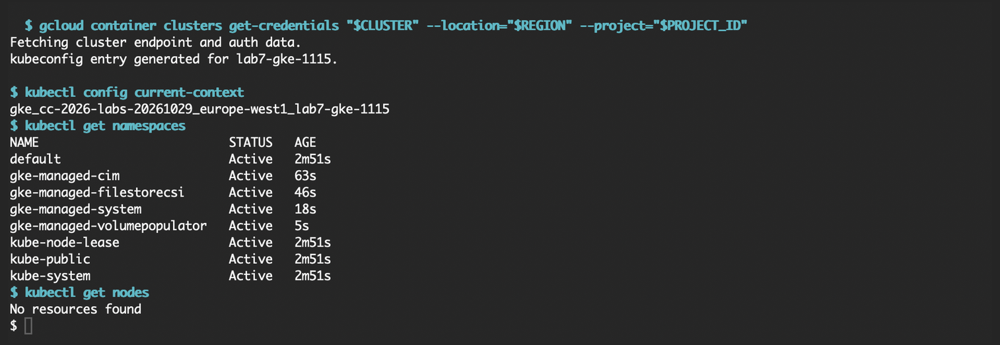

*Listing namespaces confirms that `kubectl` can reach the cluster before the first workload starts.*

<details>
<summary>🟨 Common pitfalls</summary>

- **Cluster creation fails or the name is already in use.** Run the `describe` command above. Reuse your own cluster if it is `RUNNING` with Autopilot enabled. If it is someone else's cluster, set a unique `CLUSTER` name and record it so you can restore that value in a new session. Keep the `REPOSITORY` and `IMAGE` values from your successful build. For billing, quota or network errors, share the first error with your admin. If the project uses a custom VPC, ask for the approved `--network` and `--subnetwork` values.
- **`kubectl` targets the wrong cluster or cannot connect.** Check `echo "$PROJECT_ID / $REGION / $CLUSTER"` and rerun `get-credentials` above. For a missing credentials plugin on your computer, install `gke-gcloud-auth-plugin` and rerun the command. [GKE cluster access for kubectl](https://docs.cloud.google.com/kubernetes-engine/docs/how-to/cluster-access-for-kubectl)

</details>

## 4. Deploy FastAPI

Read the two Kubernetes YAML files in `k8s/`. The [Deployment](k8s/deployment.yaml) asks for one Pod and checks `/health` before marking it ready. The [Service](k8s/service.yaml) selects Pods labelled `app: fastapi`. It routes traffic from Service port `80` to container port `8080`. Its `ClusterIP` address is internal to the cluster.

The first command replaces `LAB7_IMAGE` with the full image address before sending the Deployment YAML to Kubernetes.

```bash
sed "s|LAB7_IMAGE|${IMAGE}:v1|" k8s/deployment.yaml | kubectl apply -f -
kubectl apply -f k8s/service.yaml
```

Once both apply commands succeed, wait for the rollout and check the app's resources.

```bash
kubectl rollout status deployment/fastapi --timeout=15m
kubectl get deployment/fastapi service/fastapi
kubectl get pods -l app=fastapi
```

The first Pod can take a few minutes while Autopilot provisions a node. Continue when the Deployment reports `1/1` ready, the Pod is `Running` with `1/1` ready, and the Service type is `ClusterIP`.

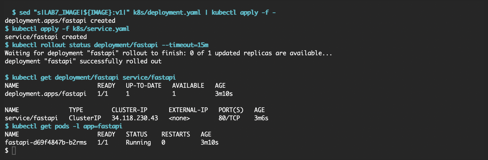

*Kubernetes reports one ready Pod and an internal Service on port `80`.*

<details>
<summary>🟨 Common pitfalls</summary>

- **The Pod stays `Pending` or rollout times out.** Run `kubectl describe pods -l app=fastapi` and read **Events**. If GKE is provisioning a node, give it a few more minutes and rerun `kubectl rollout status deployment/fastapi --timeout=15m`.
- **`ErrImagePull` or `ImagePullBackOff`.** Check **Events** and run `gcloud artifacts docker images list "$IMAGE" --include-tags --project="$PROJECT_ID"` to confirm the full URI and `v1` tag. Apply the Deployment using the `sed` command above so the manifest gets the real image URI. If events show permission denied, ask your admin for Artifact Registry Reader on the repository for the GKE node service account. [GKE node service account setup](https://docs.cloud.google.com/kubernetes-engine/security/configure-node-service-accounts)
- **The container keeps restarting.** Run `kubectl logs deployment/fastapi --previous`. Check that Uvicorn starts and listens on container port `8080`. Pod events show whether the `/health` probe failed.

</details>

## 5. Open the API

Keep this command running in your first Cloud Shell terminal. It opens Cloud Shell port `8080`. Kubernetes chooses a Pod behind the Service and uses the mapping from Service port `80` to Pod port `8080`.

```bash
kubectl port-forward service/fastapi 8080:80
```

When you see `Forwarding from 127.0.0.1:8080`, click **+ Add Cloud Shell Session** to open a second terminal tab on the same Cloud Shell VM. Run the checks there.

```bash
curl -fsS http://127.0.0.1:8080/
echo
curl -fsS http://127.0.0.1:8080/health
echo
```

```text
{"message":"Hello from FastAPI on Kubernetes"}
{"status":"ok"}
```

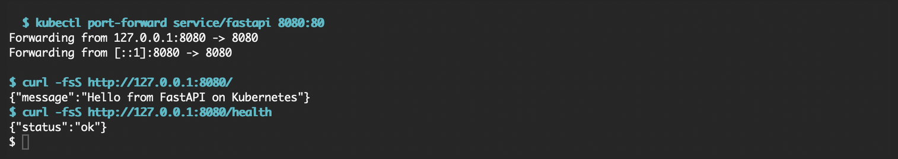

*Both routes return the expected JSON through the tunnel.*

For the browser check, click **Web Preview → Preview on port 8080** in Cloud Shell. Add `/docs` to the preview URL to open Swagger UI. Expand **GET /health**, click **Try it out**, then click **Execute** to see the HTTP `200` response.

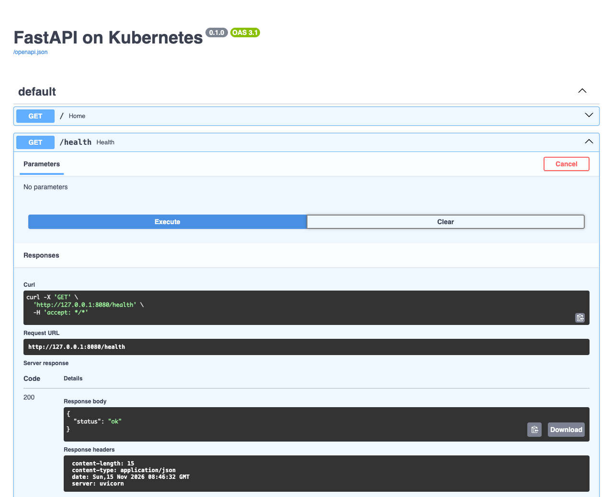

*This screenshot uses a local port-forward. In Cloud Shell, Web Preview opens a proxy hostname and Swagger UI sends the same `GET /health` request.*

<details>
<summary>🟨 Common pitfalls</summary>

- **`curl` says connection refused or the preview stops loading.** Run curl in the second **Cloud Shell** tab. Keep `kubectl port-forward` running in the first tab. If its selected Pod was replaced, run `kubectl get pods -l app=fastapi`, wait for a ready Pod and restart the forward. If you ran the forward on your own computer, browse to `http://127.0.0.1:8080/docs` on that computer.
- **`address already in use`.** Stop the earlier port-forward with **Ctrl+C** in its tab or choose a free local port with `kubectl port-forward service/fastapi 8081:80`. Use `8081` in your curl URLs and choose **Web Preview → Change port** for the browser check. Keep the Service port after the colon at `80`.

</details>

Return to the first terminal and press **Ctrl+C** to close the port-forward before continuing.

## 6. Scale the app and roll out a new version

This practice app is stateless, so you can run identical copies. Ask the Deployment for two replicas and wait for both Pods to show `1/1` ready.

```bash
kubectl scale deployment/fastapi --replicas=2
kubectl rollout status deployment/fastapi --timeout=10m
kubectl get pods -l app=fastapi
```

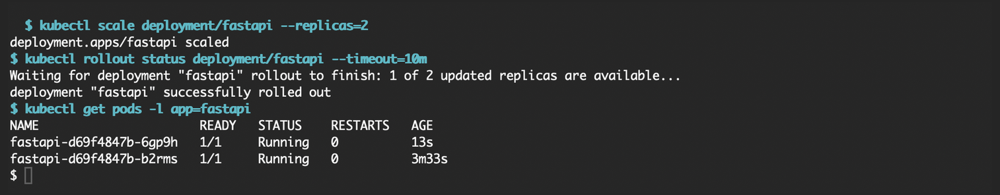

*The Deployment has created a second ready Pod.*

Copy the app to a temporary folder, then change the greeting in the copy. Build a new tag and update the Deployment to use it.

```bash
V2_DIR="$(mktemp -d)"
cp -R app "$V2_DIR/app"
sed 's/Hello from FastAPI on Kubernetes/Hello from FastAPI v2 on Kubernetes/' \
  app/main.py > "$V2_DIR/app/main.py"

gcloud builds submit "$V2_DIR/app" \
  --tag="${IMAGE}:v2" \
  --region="$REGION" \
  --project="$PROJECT_ID"
```

Wait for Cloud Build to report `SUCCESS`, then update the Deployment.

```bash
kubectl set image deployment/fastapi fastapi="${IMAGE}:v2"
kubectl rollout status deployment/fastapi --timeout=10m
kubectl get deployment/fastapi
```

Kubernetes starts Pods with the new image and retires the old Pods during a rolling update. Start the port-forward again and repeat the curl commands from [step 5](#5-open-the-api). The root route should now return `{"message":"Hello from FastAPI v2 on Kubernetes"}` and `/health` should still return `{"status":"ok"}`. Press **Ctrl+C** in the forwarding terminal when you finish.

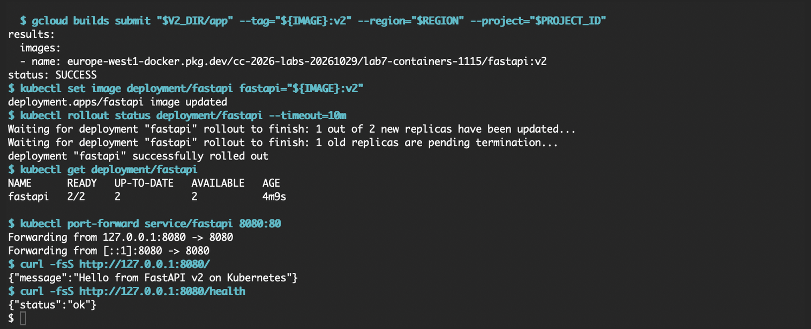

*Both replicas are ready after the update. The forwarded API returns the `v2` greeting.*

<details>
<summary>🟨 Common pitfalls</summary>

- **The old greeting remains or you resumed after `v2`.** Check `Image:` in `kubectl describe deployment fastapi`. Applying the original manifest in step 4 restores `v1` and one replica. To resume an existing `v2` rollout, check its status, then start a fresh forward to a ready Pod. For a further code change, use a fresh tag in both the build and `set image` commands. Pushing new content to the same tag leaves the Deployment's image setting unchanged. [Kubernetes image updates](https://kubernetes.io/docs/concepts/containers/images/#updating-images)
- **The new rollout fails.** Inspect the Pod events as in step 4. If you need to restore the previous Deployment revision, run `kubectl rollout undo deployment/fastapi` and then `kubectl rollout status deployment/fastapi --timeout=10m`.

</details>

### Optional public LoadBalancer exercise

The [coursework deployment](../../assignment/03-testing-and-deployment.md#kubernetes-deployment-requirements) uses a LoadBalancer Service. Try it with this demo app. Google Cloud provisions a public HTTP endpoint that can incur charges while it runs. Use demo data and follow cleanup after the check.

```bash
kubectl expose deployment fastapi --name=fastapi-public \
  --type=LoadBalancer --port=80 --target-port=8080
kubectl get service fastapi-public --watch
```

Wait for an address under `EXTERNAL-IP`, then press **Ctrl+C** to leave the watch. Replace `EXTERNAL_IP` with that address.

```bash
curl -fsS http://EXTERNAL_IP/health
echo
```

Expect `{"status":"ok"}`.

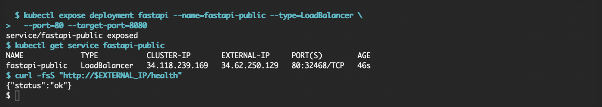

*The external IP reaches the API on HTTP port `80`.*

<details>
<summary>🟨 Common pitfalls</summary>

- **`EXTERNAL-IP` stays `<pending>`.** Run `kubectl describe service fastapi-public` and look under **Events** for provisioning progress or a project restriction. You can finish the lab with the port-forward checks and proceed to cleanup if the public Service remains unavailable.
- **There is an IP but the connection is refused or times out.** The IP can appear while Google Cloud is still configuring the load balancer. Wait a minute and retry using `http://` and the external IP in the Service output.

</details>

## 7. Cleanup

Capture the ready Pods and the API responses for your lab record. If a port-forward is still running, close it with **Ctrl+C**. Check the names against the values you saved when you created your lab resources. If you deployed the app, look up the Kubernetes context for that cluster.

```bash
printf '%s / %s / %s / %s\n' "$PROJECT_ID" "$REGION" "$CLUSTER" "$REPOSITORY"
LAB_CONTEXT="gke_${PROJECT_ID}_${REGION}_${CLUSTER}"
kubectl config get-contexts "$LAB_CONTEXT"
```

Use that context to delete any public Service first, then the internal Service and Deployment. Wait for the public Service deletion to finish so GKE can remove the load balancer.

```bash
kubectl --context="${LAB_CONTEXT:?Run the context check above first}" --namespace=default \
  delete service/fastapi-public --ignore-not-found --timeout=5m
kubectl --context="${LAB_CONTEXT:?Run the context check above first}" --namespace=default \
  delete service/fastapi deployment/fastapi --ignore-not-found
```

Delete the cluster and Docker repository you created for this lab. The repository deletion also removes its stored images and tags. Confirm each deletion when prompted.

```bash
gcloud container clusters delete "$CLUSTER" \
  --location="$REGION" --project="$PROJECT_ID"

gcloud artifacts repositories delete "$REPOSITORY" \
  --location="$REGION" --project="$PROJECT_ID"
```

List resources in your project and check that your cluster and repository are gone.

```bash
gcloud container clusters list --project="$PROJECT_ID"
gcloud artifacts repositories list --location="$REGION" --project="$PROJECT_ID"
```

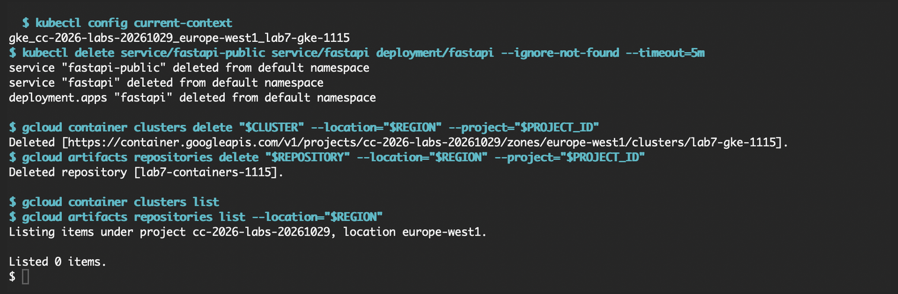

*The cluster and repository are gone from the test project.*

Cloud Build can retain source archives and logs in Cloud Storage. In a shared course project, ask the project owner about the retention policy for those files.

<details>
<summary>🟨 Common pitfalls</summary>

- **You stopped partway through the lab.** If your cluster still exists and the context is missing, rerun `get-credentials` from step 3 and check the context again. If you never deployed the app, skip the `kubectl delete` commands. If the cluster is already gone, continue with the Artifact Registry commands.
- **A delete command says `NOT_FOUND`.** Check the project, region and names with `echo "$PROJECT_ID / $REGION / $CLUSTER / $REPOSITORY"`. Use the two list commands above to confirm the resources you created are absent. If you changed tabs, rerun the exports from step 1 with your original values.

</details>

### Checklist

- [ ] Artifact Registry shows the FastAPI Docker image tagged `v1`.
- [ ] `kubectl` connects to my Autopilot cluster and shows the ready Deployment, Pod and Service.
- [ ] The forwarded API returns the expected greeting and a healthy status.
- [ ] The Deployment runs two ready Pods and the rolled-out image returns the `v2` greeting.
- [ ] If I tried the LoadBalancer, its public address returned the health response.
- [ ] My GKE cluster and Artifact Registry repository have been deleted.

[Create a GKE Autopilot cluster](https://docs.cloud.google.com/kubernetes-engine/docs/how-to/creating-an-autopilot-cluster) · [Build a Docker image with Cloud Build](https://docs.cloud.google.com/build/docs/build-push-docker-image) · [Use Cloud Shell Web Preview](https://docs.cloud.google.com/shell/docs/using-web-preview)
