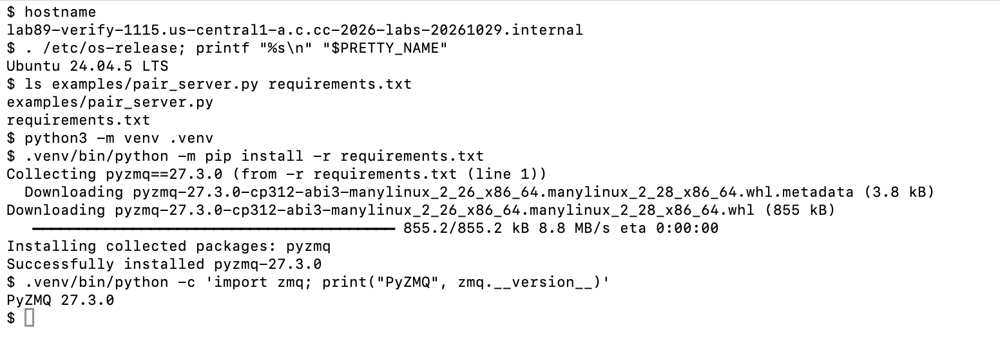
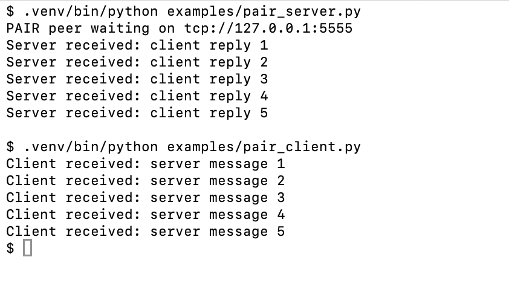
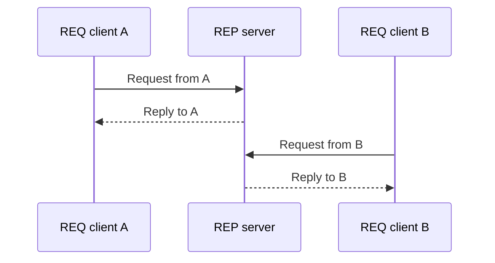
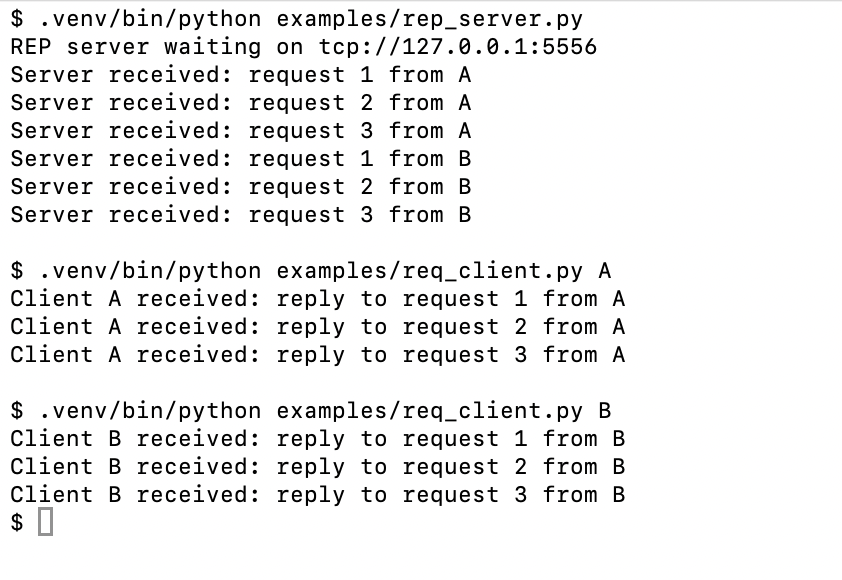
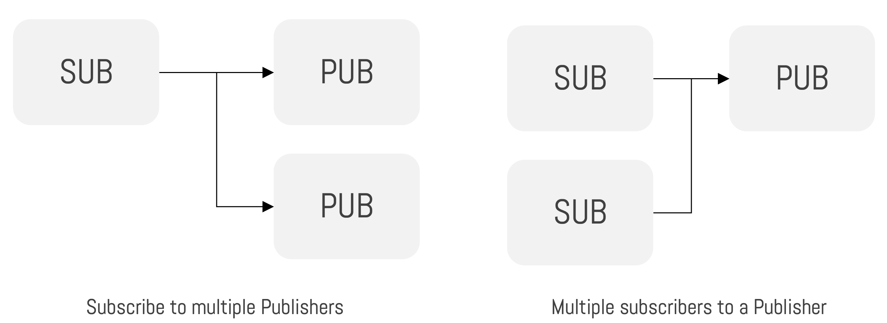
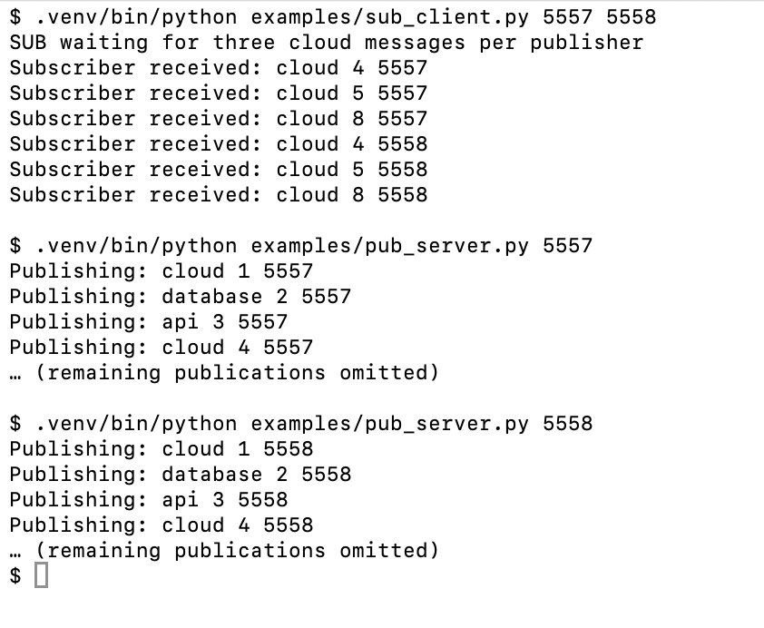
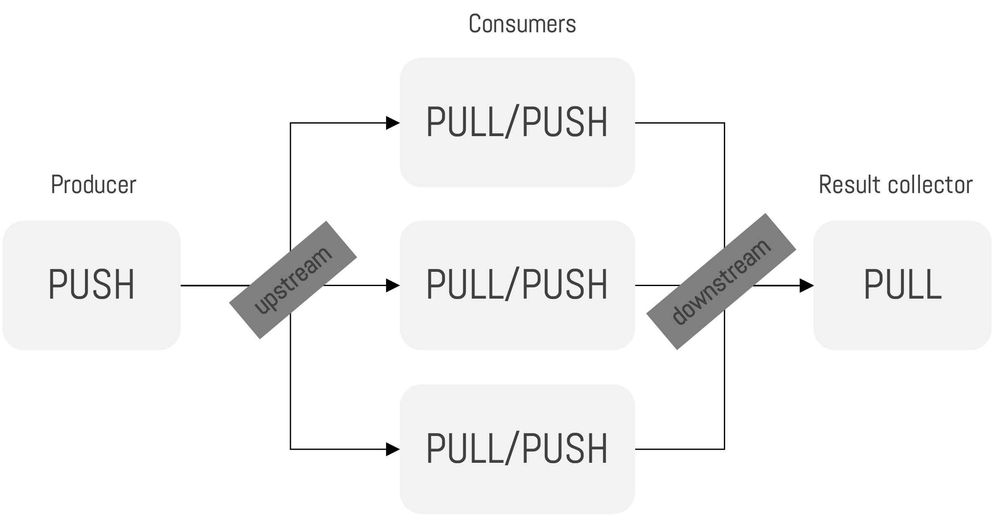
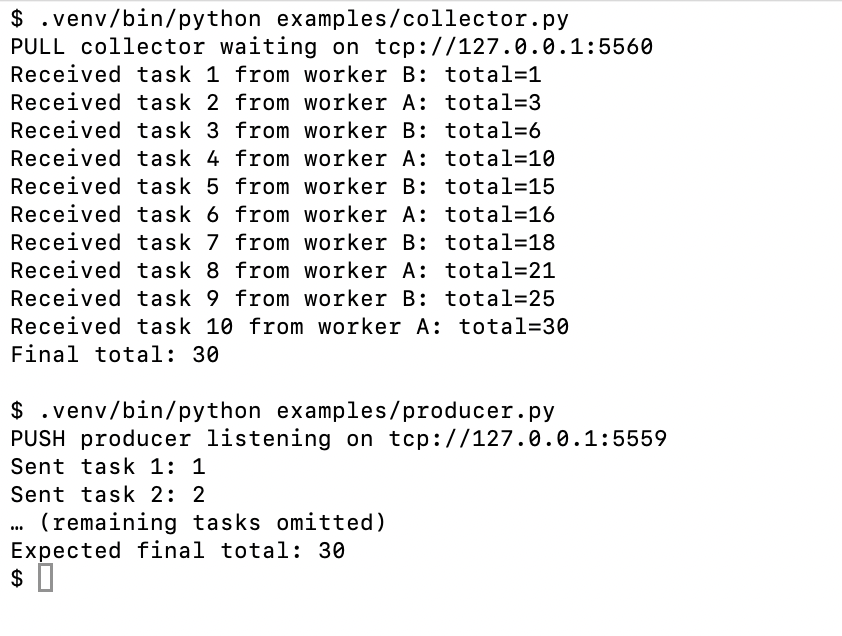
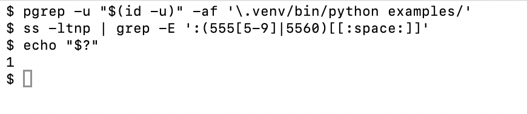

# Week 8 Lab 1 — ZeroMQ communication patterns

[Week 8 overview](../README.md)

ZeroMQ is a messaging library. Its socket types define how programs exchange messages. You will run Python programs in separate processes and watch how each pattern routes messages.

An **endpoint** is the protocol, address and port a socket uses. An example is `tcp://127.0.0.1:5555`. One program uses `bind()` to listen and the other uses `connect()` to reach it. All terminals in this lab run on the same machine, so `127.0.0.1` reaches the other processes and no cloud firewall changes are needed.

## 1. Set up the lab

Start the Week 5 Ubuntu VM in **Compute Engine → VM instances**. Click **SSH** on that VM's row and [switch to your existing `student` user](../../class-5/lab/part-2.md#5-reconnect-using-the-existing-user). You can also work on a Linux or macOS computer with Python 3.9 or newer and Git. Keep all terminals on the same machine.

Clone the course repo once. If you opened this tutorial on a GitHub branch other than `main`, add `--branch BRANCH_NAME` to `git clone` and use the branch shown on the tutorial page. If you already have the current course repo on this machine, skip this block.

```bash
cd ~
git clone --depth 1 https://github.com/warestack/cc.git week8-cc
```

Enter the lab directory and set up PyZMQ. If your course repo is in a different folder, adjust the path in the first command.

```bash
cd ~/week8-cc/class-8/lab
ls examples/pair_server.py requirements.txt
python3 -m venv .venv
.venv/bin/python -m pip install -r requirements.txt
.venv/bin/python -c 'import zmq; print("PyZMQ", zmq.__version__)'
```

Expect `PyZMQ 27.3.0`. Prepare up to four SSH terminals on the same VM as the same user. Use the commands below in each new terminal to enter the lab folder and confirm the interpreter. If your repo is somewhere else, use that path.

```bash
cd ~/week8-cc/class-8/lab
.venv/bin/python --version
```

Each example uses `.venv/bin/python` directly, so a fresh terminal can run it without activating the environment. Reuse the terminals as you move through the patterns. Have all terminals for a pattern ready before starting because an idle socket times out after one minute.



*The lab interpreter can import PyZMQ. These screenshots group terminal output from the examples run on one Compute Engine Ubuntu VM.*

<details>
<summary>🟨 Common pitfalls</summary>

- **`venv` creation reports missing `ensurepip` on Ubuntu.** Run `sudo apt update` and `sudo apt install python3-venv`, then repeat the virtual environment command.
- **Git is missing on Ubuntu.** Run `sudo apt update` and `sudo apt install git`, then clone again.
- **An example or `.venv/bin/python` cannot be found.** Run `pwd` and check the folder. Every terminal needs the same lab directory. If the example is missing from your clone, switch to the branch that includes this version of the lab.
- **`No module named zmq`.** Install the requirements using `.venv/bin/python -m pip install -r requirements.txt` and make sure your example command also starts with `.venv/bin/python`.

</details>

## 2. Pair — one peer to one peer


The [first peer](examples/pair_server.py) binds a `PAIR` socket and sends the first message. The [second peer](examples/pair_client.py) connects, receives that message, then sends its reply. The two programs decide whose turn it is.

**Terminal 1**

```bash
.venv/bin/python examples/pair_server.py
```

**Terminal 2**, after terminal 1 says it is waiting

```bash
.venv/bin/python examples/pair_client.py
```

The server prints `client reply 1` through `client reply 5`. The client prints `server message 1` through `server message 5`. Both programs exit.



*Each peer received five messages from its one partner.*

<details>
<summary>🟨 Common pitfalls</summary>

- **One peer timed out.** Stop either peer that is still running. Restart the server first and connect the client within one minute.
- **The peer reports `Address already in use`.** Check for an old Pair process using port `5555`. Stop that process as shown in [cleanup](#6-clean-up).
- **You opened a third peer.** Stop it. This example uses one direct connection between two `PAIR` peers.

</details>

## 3. Request/Reply — two clients, one server



The [server](examples/rep_server.py) uses a `REP` socket. It receives a request before sending its reply. A [client](examples/req_client.py) uses a `REQ` socket. It sends a request and waits for a reply before sending the next request. This pattern is useful when a caller needs an answer.

**Terminal 1**

```bash
.venv/bin/python examples/rep_server.py
```

**Terminal 2**

```bash
.venv/bin/python examples/req_client.py A
```

**Terminal 3**

```bash
.venv/bin/python examples/req_client.py B
```

Each client runs three exchanges and exits. The server exits after six requests. The order of the two clients' requests can vary. The server replies to whichever client sent each request.



*Look for requests from A and B on the server and matching replies on each client.*

<details>
<summary>🟨 Common pitfalls</summary>

- **The server prints three requests and keeps waiting.** Start client B. The server expects six requests per run.
- **A modified client prints `Operation cannot be accomplished in current state`.** A `REQ` socket alternates send, receive. A `REP` socket alternates receive, send. Restore that order and run both sides again.

</details>

## 4. Publish/Subscribe — filter topics



*The arrows show which sockets connect. Published messages flow from `PUB` to `SUB`.*

The [publishers](examples/pub_server.py) send messages beginning with `cloud`, `database`, or `api`. The [subscriber](examples/sub_client.py) connects to both publishers and subscribes to the prefix `cloud `. The space is part of the prefix. Each published message ends with the port that identifies its sender.

Start the subscriber first, then run both publishers. Each publisher sends twenty messages over several seconds, giving the subscription time to reach it.

**Terminal 1**

```bash
.venv/bin/python examples/sub_client.py 5557 5558
```

**Terminal 2**

```bash
.venv/bin/python examples/pub_server.py 5557
```

**Terminal 3**

```bash
.venv/bin/python examples/pub_server.py 5558
```

The subscriber prints three matching messages per port and exits. Publishers exit when they finish sending. Compare the output. Publishers list all three topics, while the subscriber prints only `cloud` messages. The message numbers and order can vary because subscriptions and message transfers are asynchronous.



*Check for only `cloud` messages in the subscriber and both ports at the ends of its lines.*

<details>
<summary>🟨 Common pitfalls</summary>

- **The subscriber missed some early messages.** A publisher can send before the connection and subscription are ready. This is the *slow joiner* behavior. The demo needs three later messages from each publisher. If you did not reach that count, restart the subscriber if it exited, then rerun both publishers.
- **Messages arrive from only one port.** Check that the second publisher uses the other port listed in the subscriber command.

</details>

## 5. Push/Pull — distribute work



*This diagram shows three workers. The lab runs two.*

The [producer](examples/producer.py) pushes ten numbered tasks. Two [workers](examples/worker.py) pull jobs from the producer and push results to the [collector](examples/collector.py). The collector receives the results and adds the numbers. A task goes to one worker, while a publication can reach multiple subscribers.

Open all four terminals before starting. Run the collector first, then both workers, then the producer.

**Terminal 1**

```bash
.venv/bin/python examples/collector.py
```

**Terminal 2**

```bash
.venv/bin/python examples/worker.py A
```

**Terminal 3**

```bash
.venv/bin/python examples/worker.py B
```

**Terminal 4**

```bash
.venv/bin/python examples/producer.py
```

The collector should list task IDs 1 through 10 once each and print `Final total: 30`. The producer prints `Expected final total: 30`. Check that both worker labels appear. Work is shared when both workers are connected. The order of the results may vary. Once the collector and producer exit, press **Ctrl+C** in both worker terminals.



*Check both worker labels and the matching totals.*

<details>
<summary>🟨 Common pitfalls</summary>

- **Only one worker processed tasks.** Stop both workers, then run the whole pipeline again. Start both workers and check that both print `waiting for tasks` before starting the producer.
- **The collector is still waiting for results.** Check all four terminals for errors. Tasks use port `5559` and results use port `5560`. If a worker or collector stopped mid-run, stop your remaining lab processes and rerun the pipeline from the first command.
- **Workers are still waiting after the final total.** Press **Ctrl+C** in each worker terminal. Workers wait for more jobs until you stop them or the socket timeout expires.

</details>

## 6. Clean up

Stop any remaining lab program with **Ctrl+C** in its own terminal. On the Ubuntu VM, check for your example processes and listening ports.

```bash
pgrep -u "$(id -u)" -af '\.venv/bin/python examples/'
ss -ltnp | grep -E ':(555[5-9]|5560)[[:space:]]'
```

No output means the checks found neither a running example nor a listener on a lab port. If a process still appears and you cannot find its terminal, note the PID at the start of the `pgrep` line or after `pid=` in the `ss` line. Replace `YOUR_PID` with that number in the inspection command.

```bash
ps -fp YOUR_PID
```

If the output identifies your own ZeroMQ example, stop that one process with `kill YOUR_PID` and run the port check again. On macOS, use `lsof -nP -iTCP:5555-5560 -sTCP:LISTEN` to inspect the same ports. Keep the source and the virtual environment for review. When you finish using the VM, stop it in **Compute Engine → VM instances** and retain its disk.



*No example is running and no ZeroMQ listener remains on ports `5555`–`5560`. The final `1` is `grep`'s status when it finds no matching lines.*

### Checklist

- [ ] Two `PAIR` peers each printed five messages.
- [ ] Both `REQ` clients received three replies and the `REP` server handled six requests.
- [ ] The subscriber printed only `cloud` messages and received them from both publisher ports.
- [ ] The collector received tasks from both workers and matched the producer's total.
- [ ] All lab processes have stopped.

[ZeroMQ socket patterns](https://zeromq.org/socket-api/) · [The ZeroMQ Guide](https://zguide.zeromq.org/docs/chapter1/)
