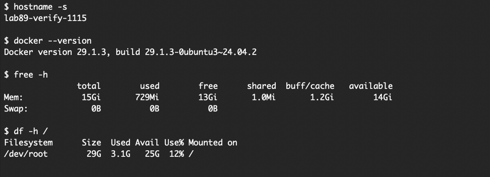
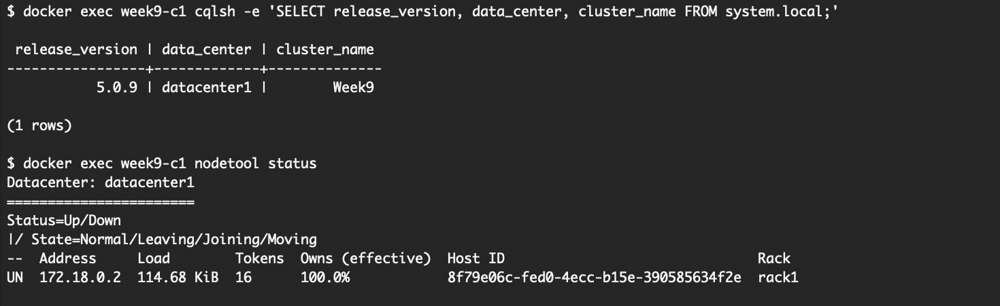
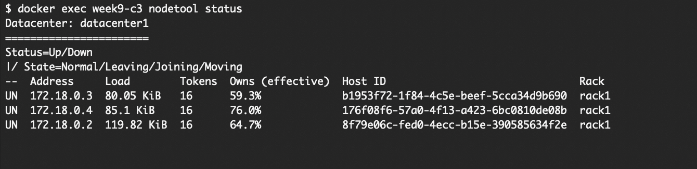
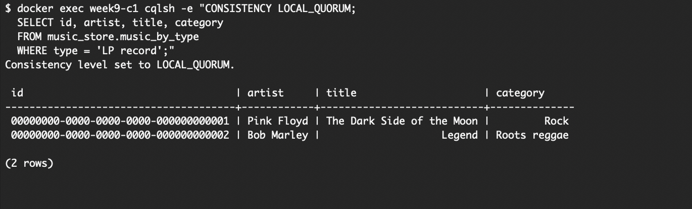
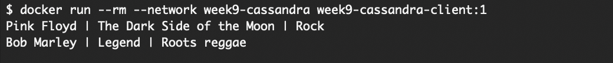
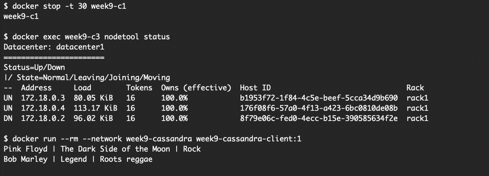
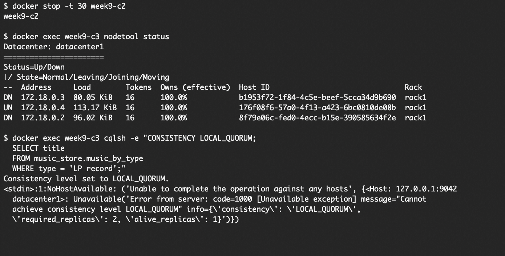
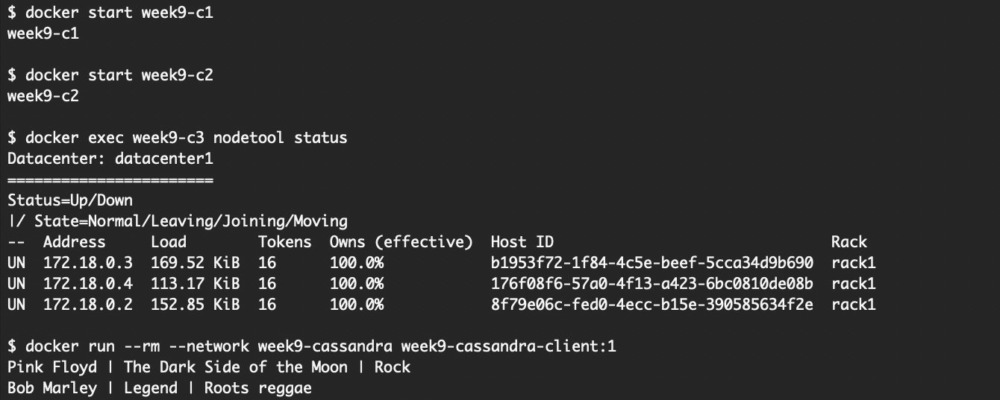

# Week 9 Lab 1 — Apache Cassandra with Docker and Python

[Week 9 overview](../README.md)

Cassandra is a distributed database. This lab runs three Cassandra nodes in containers and stores three replicas of each partition. You will query the same data as nodes go down and come back. All three nodes share one VM, so stopping the VM takes down the entire practice cluster.

## 1. Prepare the VM

Start your Ubuntu Compute Engine VM and connect through **Compute Engine → VM instances → SSH**. If you are using the Week 5 VM, [switch to the existing `student` user](../../class-5/lab/part-2.md#5-reconnect-using-the-existing-user).

For a dedicated VM, use the Week 5 setup steps with Ubuntu 24.04 LTS, an `e2-standard-4` machine, and a boot disk of at least 30 GB. Install Docker and verify that the lab user can run it. [Create the VM](../../class-5/lab/part-1.md#2-configure-the-vm) · [Set up Docker](../../class-5/lab/part-4.md#3-install-and-start-docker).

Run these commands on the **VM**, using the SSH terminal:

```bash
hostname -s
docker version --format '{{.Server.Version}}'
free -h
df -h /
```

Each Cassandra container has a 2 GiB limit. Check that existing workloads leave enough memory and disk space before starting all three containers. If your Week 5 VM has its original machine type or 10 GB boot disk, resize it or use a dedicated VM. [Change the machine type](https://docs.cloud.google.com/compute/docs/instances/changing-machine-type-of-stopped-instance) · [Increase the boot disk size](https://docs.cloud.google.com/compute/docs/disks/resize-persistent-disk)



*The 16 GB test VM shows about 15 GiB of usable memory and 25 GiB of free disk space.*

<details>
<summary>🟨 Common pitfalls</summary>

- **Docker reports permission denied.** Run `docker ps` to check access and follow [Week 5's Docker access steps](../../class-5/lab/part-4.md#4-give-your-lab-user-access) if needed. Reconnect after adding the lab user to the Docker group.
- **The VM is too small.** Stop it in Compute Engine before changing its machine type, and keep its existing disk. Restart it and reconnect before continuing.
- **`hostname -s` shows a different machine.** Go back to the VM row in Compute Engine and open SSH there. Cloud Shell has its own hostname and resources.

</details>

## 2. Start the first node

Create a user-defined Docker network and pull the pinned Docker Official Image. If the network already exists from a previous run, reuse it. If a lab container already exists, use the resume instructions below or [clean up](#7-clean-up) before starting over.

```bash
docker network inspect week9-cassandra >/dev/null 2>&1 || docker network create week9-cassandra
CASSANDRA_IMAGE=cassandra:5.0.9
docker pull "$CASSANDRA_IMAGE"
```

Containers on this network can resolve each other by name. The examples leave the Cassandra port inside the Docker network, where the lab's client will connect. No GCP firewall rule is needed. [Cassandra image](https://hub.docker.com/_/cassandra) · [Docker bridge networking](https://docs.docker.com/engine/network/drivers/bridge/)

Paste this function in the same VM terminal. It starts a node with the same cluster, datacenter and rack settings each time.

```bash
start_node() {
  docker run -d --name "$1" --network week9-cassandra --memory 2g \
    -e CASSANDRA_CLUSTER_NAME=Week9 \
    -e CASSANDRA_ENDPOINT_SNITCH=GossipingPropertyFileSnitch \
    -e CASSANDRA_DC=datacenter1 -e CASSANDRA_RACK=rack1 \
    -e CASSANDRA_SEEDS=week9-c1 \
    -e MAX_HEAP_SIZE=768M -e HEAP_NEWSIZE=192M \
    "$CASSANDRA_IMAGE"
}
```

Start the seed node. If `week9-c1` already exists, use `docker start week9-c1` when it shows `Exited`, or go to the status checks if it is already running.

```bash
start_node week9-c1
```

`week9-c1` is the **seed**. It gives joining nodes an address through which to discover cluster membership. Each node can coordinate requests once the cluster is ready.

Check the first node. Cassandra can take a few minutes to start. Retry these commands until `cqlsh` prints a row and `nodetool` shows the seed as `UN`. A fresh cluster has one row at this point.

```bash
docker exec week9-c1 cqlsh -e 'SELECT release_version, data_center, cluster_name FROM system.local;'
docker exec week9-c1 nodetool status
```



*The node accepts CQL queries and reports `UN` (Up and Normal).*

## 3. Add two more nodes

Start one follower at a time. Before starting the third node, wait until the seed and the second node are both `UN`. When resuming, use `docker start` for each existing follower that shows `Exited`. If a follower is already running, go to its status check.

```bash
start_node week9-c2
docker exec week9-c1 nodetool status
```

```bash
start_node week9-c3
docker exec week9-c1 nodetool status
```

Wait until all **three** rows report `UN` in `datacenter1`. `UJ` means Up and Joining. Check the same cluster from another node:

```bash
docker exec week9-c3 nodetool status
```



*All three nodes have joined the same datacenter. The container IP addresses can differ on your VM. Use `docker network inspect week9-cassandra` to match addresses to container names.*

<details>
<summary>🟨 Common pitfalls</summary>

- **A container shows Up but `cqlsh` refuses the connection.** Run `docker logs --tail 40 week9-c1` and wait for startup. Check again before adding followers.
- **Only one node appears after the second starts.** Run `docker logs --tail 40 week9-c2`, then `docker network inspect week9-cassandra`. Check that both containers are on the same network and that the follower uses `week9-c1` as its seed.
- **A container exits during startup.** Use `docker ps -a` and `docker inspect --format '{{.State.OOMKilled}}' week9-c2` for the affected node. A value of `true` indicates a memory-limit kill. Check the configured heap and free VM memory.
- **The network or a container already exists.** Use `docker network inspect week9-cassandra` and `docker ps -a --filter 'name=week9-c'` to check what is there. Resume your existing lab resources. For an empty cluster, follow the cleanup step before starting again.
- **A restart of the SSH session loses `start_node`.** Set `CASSANDRA_IMAGE=cassandra:5.0.9` and paste the function's code block from [step 2](#2-start-the-first-node) again. Check existing container names with `docker ps -a` before resuming.

</details>

## 4. Create and query a table

Open the CQL shell on one of the running nodes:

```bash
docker exec -it week9-c1 cqlsh
```

Paste the following into **`cqlsh>`**. A **keyspace** is a namespace for tables and defines how Cassandra replicates their data. For this keyspace, `NetworkTopologyStrategy` asks Cassandra to store three replicas of each partition in `datacenter1`. At `LOCAL_QUORUM`, reads and writes require responses from two of those three replicas. [Cassandra replication and consistency](https://cassandra.apache.org/doc/stable/cassandra/architecture/dynamo.html)

```sql
CREATE KEYSPACE IF NOT EXISTS music_store
  WITH replication = {'class': 'NetworkTopologyStrategy', 'datacenter1': 3};

USE music_store;
CONSISTENCY LOCAL_QUORUM;

CREATE TABLE IF NOT EXISTS music_by_type (
  type text,
  id uuid,
  category text,
  artist text,
  title text,
  PRIMARY KEY (type, id)
);
```

`type` is the **partition key**, so Cassandra can find the partition by the record format. `id` distinguishes records within that partition. The fixed example UUIDs make the insert, update and delete commands easy to repeat.

Insert two rows, then read them by partition key:

```sql
INSERT INTO music_by_type (type, id, category, artist, title)
VALUES ('LP record', 00000000-0000-0000-0000-000000000001,
        'Rock', 'Pink Floyd', 'The Dark Side of the Moon');

INSERT INTO music_by_type (type, id, category, artist, title)
VALUES ('LP record', 00000000-0000-0000-0000-000000000002,
        'Reggae', 'Bob Marley', 'Legend');

SELECT id, artist, title, category FROM music_by_type WHERE type = 'LP record';
```

Update a row by its full primary key. Then insert and delete a temporary practice row:

```sql
UPDATE music_by_type SET category = 'Roots reggae'
WHERE type = 'LP record' AND id = 00000000-0000-0000-0000-000000000002;

INSERT INTO music_by_type (type, id, category, artist, title)
VALUES ('LP record', 00000000-0000-0000-0000-000000000003,
        'Practice', 'Example Artist', 'Temporary row');

DELETE FROM music_by_type
WHERE type = 'LP record' AND id = 00000000-0000-0000-0000-000000000003;

SELECT id, artist, title, category FROM music_by_type WHERE type = 'LP record';
```

Expect two rows again. `Legend` now has the category `Roots reggae`, and the temporary row is gone.



*The read returns the two retained records after the update and delete.*

```sql
SELECT replication
FROM system_schema.keyspaces
WHERE keyspace_name = 'music_store';
```

Check that the keyspace uses `NetworkTopologyStrategy` with three replicas in `datacenter1`. Then type `EXIT` to return to the VM terminal.

<details>
<summary>🟨 Common pitfalls</summary>

- **The prompt changes to `...`.** Finish the CQL statement with a semicolon. Press **Ctrl+C** to discard an unfinished statement.
- **Cassandra asks for a keyspace.** Enter `USE music_store;` after opening a new `cqlsh` session. Set `CONSISTENCY LOCAL_QUORUM;` again in the new session.
- **The update targets the wrong row.** Use both `type` and the matching UUID in `WHERE`. Check them with the partition-key query before editing.

</details>

## 5. Query Cassandra from Python

Create a project folder in the VM terminal:

```bash
mkdir -p ~/week9-cassandra
cd ~/week9-cassandra
```

Open `pico query_music.py`, paste the script, then save with **Ctrl+O → Enter** and exit with **Ctrl+X**.

```python
from cassandra import ConsistencyLevel
from cassandra.cluster import EXEC_PROFILE_DEFAULT, Cluster, ExecutionProfile
from cassandra.policies import DCAwareRoundRobinPolicy


contact_points = ["week9-c1", "week9-c2", "week9-c3"]
profile = ExecutionProfile(
    load_balancing_policy=DCAwareRoundRobinPolicy(local_dc="datacenter1"),
    consistency_level=ConsistencyLevel.LOCAL_QUORUM,
)

with Cluster(
    contact_points,
    protocol_version=5,
    execution_profiles={EXEC_PROFILE_DEFAULT: profile},
) as cluster:
    session = cluster.connect("music_store")
    rows = session.execute(
        "SELECT artist, title, category FROM music_by_type WHERE type = %s",
        ("LP record",),
    )

    for row in rows:
        print(f"{row.artist} | {row.title} | {row.category}")
```

The **contact points** give the driver initial addresses, and the driver discovers cluster members after connecting. The execution profile uses `datacenter1` and requests local quorum reads. Leaving the `with` block closes the connection.

Open `pico Dockerfile` in the same folder and save the following:

```dockerfile
FROM python:3.12-slim

WORKDIR /lab
RUN python -m pip install --no-cache-dir cassandra-driver==3.30.1
COPY query_music.py .
CMD ["python", "query_music.py"]
```

Build the client and run it on the same network as the Cassandra nodes.

```bash
docker build -t week9-cassandra-client:1 .
docker run --rm --network week9-cassandra week9-cassandra-client:1
```



*Docker resolves the three contact-point names on the bridge network. Python reads the two rows.*

<details>
<summary>🟨 Common pitfalls</summary>

- **The VM does not have `pico`.** Install the Ubuntu package with `sudo apt update` and `sudo apt install nano`. Then open the files with `pico` or `nano`.
- **The client says it cannot resolve a contact point.** Check that the client command includes `--network week9-cassandra`. Use the same node names as in Steps 2–3.
- **Python reports an unknown keyspace or table.** Complete Step 4 in `cqlsh`. Verify that the script uses `music_store` and `music_by_type`.
- **An edit to the script does not change the output.** Run the build command again before starting the client.

</details>

## 6. Test failover and recovery

### Stop one node

Stop the seed node and check status from a surviving node.

```bash
docker stop -t 30 week9-c1
docker exec week9-c3 nodetool status
```

Wait until status shows **two `UN` rows and one `DN` row**, then run the client. `DN` means Down and Normal in the cluster's membership information.

```bash
docker run --rm --network week9-cassandra week9-cassandra-client:1
```

Expect Python to return both records. The two live replicas can satisfy `LOCAL_QUORUM`.



*The client can still read at local quorum after the seed stops.*

### Stop a second node

Leave the first node stopped and stop `week9-c2`.

```bash
docker stop -t 30 week9-c2
docker exec week9-c3 nodetool status
```

Wait until status from `week9-c3` shows **one `UN` and two `DN` rows**. Then ask the remaining node to read the same partition.

```bash
docker exec week9-c3 cqlsh -e "CONSISTENCY LOCAL_QUORUM; SELECT title FROM music_store.music_by_type WHERE type = 'LP record';"
```

Look for `Unavailable` in the response. The lab run showed it inside `NoHostAvailable`, with `required_replicas: 2` and `alive_replicas: 1`. The coordinator answered, but the read could not reach quorum.



*The remaining node reports that it cannot meet the requested consistency level.*

### Restore the nodes

Start the seed again.

```bash
docker start week9-c1
docker exec week9-c3 nodetool status
```

Wait for **two** `UN` rows before starting the second node.

```bash
docker start week9-c2
docker exec week9-c3 nodetool status
```

Wait for **three** `UN` rows, then run the Python client again and check both records.

```bash
docker run --rm --network week9-cassandra week9-cassandra-client:1
```



*Both restarted nodes rejoin. The same query succeeds after recovery.*

<details>
<summary>🟨 Common pitfalls</summary>

- **Status still shows `UN` immediately after a stop.** Wait a few seconds for the surviving nodes to detect the change, then retry `nodetool status`.
- **The two-node outage test loses its connection.** Run `cqlsh` inside `week9-c3`, which remains running for this test.
- **A restarted container does not rejoin.** Use `docker logs --tail 40` with that container's name and check its startup, then check status from `week9-c3` again. Use `docker start` on the original containers to retain their data.

</details>

## 7. Clean up

After saving any evidence you need, stop and remove the practice containers and their anonymous Cassandra data volumes, then remove the network. The `-v` flag in this command deletes this lab's database data.

If you stopped partway through setup, run `docker ps -a --filter 'name=week9-c'` first and use only the container names that exist in the stop and remove commands.

```bash
docker stop -t 30 week9-c1 week9-c2 week9-c3
docker rm -v week9-c1 week9-c2 week9-c3
docker network rm week9-cassandra
docker ps -a --filter 'name=week9-c'
docker network ls --filter 'name=week9-cassandra'
```

The final two commands should show headers with no matching entries.

When finished, open **Compute Engine → VM instances**. If you reused the Week 5 VM, stop it and keep its boot disk for later labs. If you created a dedicated Week 9 VM, you can delete it and its boot disk after saving your evidence and any files you want to keep.

### Checkpoint

- [ ] Three Cassandra containers showed `UN` in the same datacenter.
- [ ] You inserted, read, updated and deleted a row in CQL.
- [ ] The Python client queried by partition key using container names.
- [ ] A local quorum read succeeded with two live replicas and returned `Unavailable` with one.
- [ ] You restarted the two nodes, verified recovery and removed the lab containers and network.
